# Error-state catalogue

Every error state in the [Phase 34 inventory](../tests/error-states/inventory.ts), photographed in a headless Chrome on the real app (plan/phase-35.md): at phone and desktop widths, in light and dark mode. Each entry says when it happens, what the person sees, and the test that proves it.

How the failures are caused: the app runs in local fault mode (`MUSIC_CHAIRS_FAULTS=1`), where it talks to a stand-in for Google that can refuse, grant only part of a permission, fail or be slow, and where a `mc_fault=crash` cookie makes the server fail while building a page. Network failures are made in the browser: a dropped connection (the request never reaches the server), a gateway answering 500, or no answer within 20 seconds.

The check in `tests/error-catalogue.test.ts` proves every inventory state has its four pictures and an entry here, and the script only photographs a state once its expected text or element is on screen. Whether each picture is right stays with you.

Regenerate everything, or only some states (from `project/`; see its README). Dates and generated names on the pages change from run to run, so a full regeneration rewrites every picture (about 12 MB in the repository's history); regenerating only the states that changed keeps that small.

```sh
corepack pnpm run catalogue
```

```sh
corepack pnpm run catalogue --only "routes/request POST set-date browser-failure" --only "server crash"
```

## Page loads

### routes/calendar-feed GET · unknown-feed

- **When:** A calendar app asks for a feed that no longer exists (member removed)
- **You see:** The calendar app reports the feed is gone
- **Proved by:** the probe replayed in tests/error-states.test.tsx (answers every probe as the inventory says)

 

Desktop: [light](images/routes-calendar-feed-get--unknown-feed--desktop-light.webp) · [dark](images/routes-calendar-feed-get--unknown-feed--desktop-dark.webp)

### routes/group GET · unknown-group

- **When:** The group's address matches no group (deleted, or a mistyped link)
- **You see:** “Page not found”
- **Proved by:** the probe replayed in tests/error-states.test.tsx (answers every probe as the inventory says)

 

Desktop: [light](images/routes-group-get--unknown-group--desktop-light.webp) · [dark](images/routes-group-get--unknown-group--desktop-dark.webp)

### routes/group GET · unreachable

- **When:** Moving to this page in the app while the connection is down, or the server errs
- **You see:** “Couldn't reach music-chairs” (or “Something went wrong on our side”) with Try again and the way back
- **Proved by:** tests/error-states.test.tsx: the error page names a missing page, an organizer-only page, our failure and a lost connection; browser gate: page load offline: the connection error page with Try again

 

Desktop: [light](images/routes-group-get--unreachable--desktop-light.webp) · [dark](images/routes-group-get--unreachable--desktop-dark.webp)

### routes/groups GET · unreachable

- **When:** Moving to this page in the app while the connection is down, or the server errs
- **You see:** “Couldn't reach music-chairs” (or “Something went wrong on our side”) with Try again and the way back
- **Proved by:** tests/error-states.test.tsx: the error page names a missing page, an organizer-only page, our failure and a lost connection; browser gate: page load offline: the connection error page with Try again

 

Desktop: [light](images/routes-groups-get--unreachable--desktop-light.webp) · [dark](images/routes-groups-get--unreachable--desktop-dark.webp)

### routes/healthz GET · ok

- **When:** The deploy checks the server
- **You see:** Nobody: the deploy reads “ok”
- **Proved by:** the probe replayed in tests/error-states.test.tsx (answers every probe as the inventory says)

 

Desktop: [light](images/routes-healthz-get--ok--desktop-light.webp) · [dark](images/routes-healthz-get--ok--desktop-dark.webp)

### routes/home GET · notice

- **When:** Back from Google sign-in or consent that didn't fully work
- **You see:** What happened, in a notice at the top
- **Proved by:** tests/error-states.test.tsx: home and each page show their own notices; the root shows the rest, each once

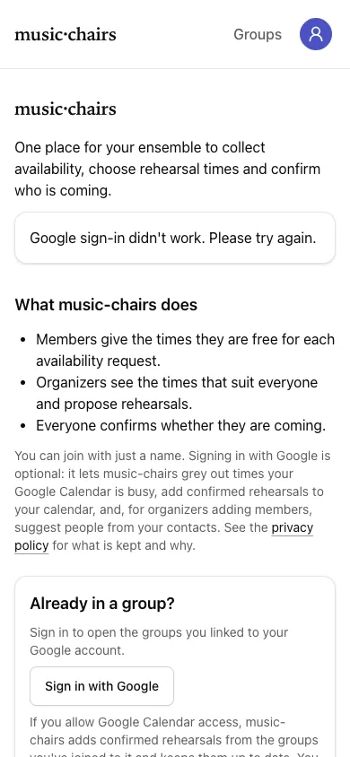 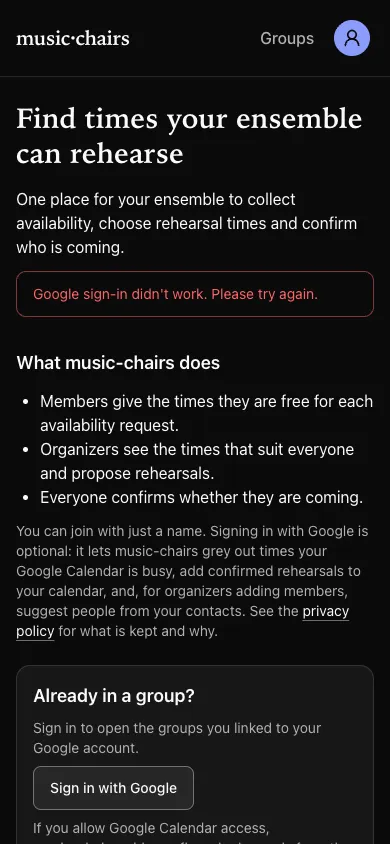

Desktop: [light](images/routes-home-get--notice--desktop-light.webp) · [dark](images/routes-home-get--notice--desktop-dark.webp)

### routes/home GET · unreachable

- **When:** Moving to this page in the app while the connection is down, or the server errs
- **You see:** “Couldn't reach music-chairs” (or “Something went wrong on our side”) with Try again and the way back
- **Proved by:** tests/error-states.test.tsx: the error page names a missing page, an organizer-only page, our failure and a lost connection; browser gate: page load offline: the connection error page with Try again

 

Desktop: [light](images/routes-home-get--unreachable--desktop-light.webp) · [dark](images/routes-home-get--unreachable--desktop-dark.webp)

### routes/join GET · unknown-invite

- **When:** An invite link that matches no group
- **You see:** “Page not found”
- **Proved by:** the probe replayed in tests/error-states.test.tsx (answers every probe as the inventory says)

 

Desktop: [light](images/routes-join-get--unknown-invite--desktop-light.webp) · [dark](images/routes-join-get--unknown-invite--desktop-dark.webp)

### routes/join GET · unreachable

- **When:** Moving to this page in the app while the connection is down, or the server errs
- **You see:** “Couldn't reach music-chairs” (or “Something went wrong on our side”) with Try again and the way back
- **Proved by:** tests/error-states.test.tsx: the error page names a missing page, an organizer-only page, our failure and a lost connection; browser gate: page load offline: the connection error page with Try again

 

Desktop: [light](images/routes-join-get--unreachable--desktop-light.webp) · [dark](images/routes-join-get--unreachable--desktop-dark.webp)

### routes/members.add GET · contacts-none

- **When:** Google has no contacts with an email address
- **You see:** “No contacts with an email address were found”
- **Proved by:** tests/error-states.test.tsx: says what happened to Google contacts: unreadable, removed or none found

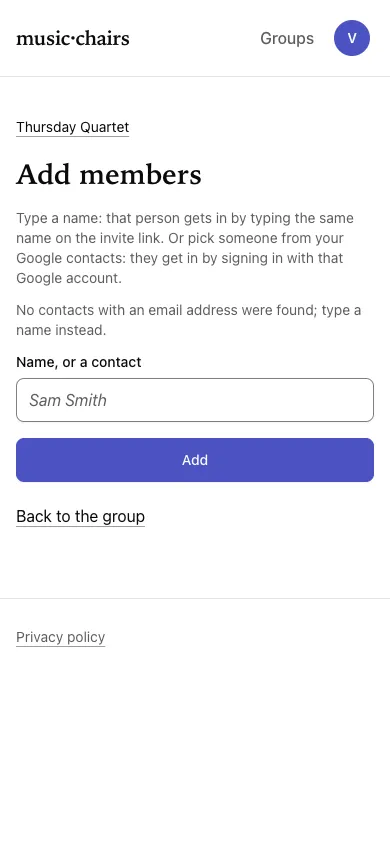 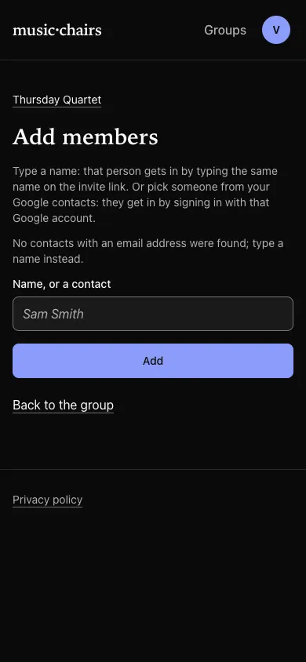

Desktop: [light](images/routes-members-add-get--contacts-none--desktop-light.webp) · [dark](images/routes-members-add-get--contacts-none--desktop-dark.webp)

### routes/members.add GET · contacts-unreadable

- **When:** Google contacts can't be read (an error, no answer within 5 seconds, or access removed)
- **You see:** “Couldn't read your Google contacts right now” or “access was removed” with Reconnect; typing a name still works
- **Proved by:** tests/error-states.test.tsx: says what happened to Google contacts: unreadable, removed or none found

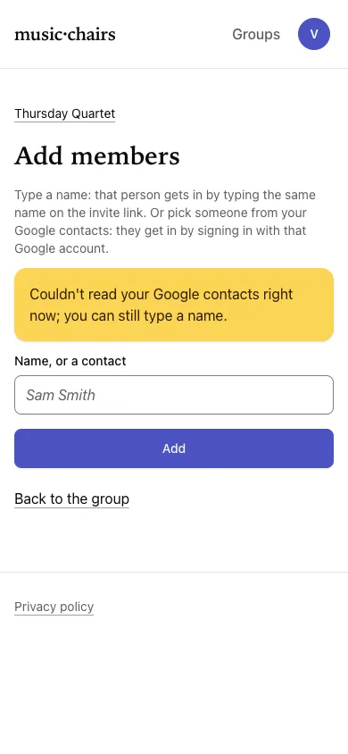 

Desktop: [light](images/routes-members-add-get--contacts-unreadable--desktop-light.webp) · [dark](images/routes-members-add-get--contacts-unreadable--desktop-dark.webp)

### routes/members.add GET · organizer-only

- **When:** A member who isn't an organizer asks (for example after losing the role)
- **You see:** “Only organizers can see this”, with the way back to the group
- **Proved by:** the probe replayed in tests/error-states.test.tsx (answers every probe as the inventory says)

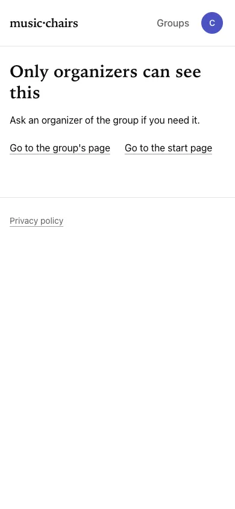 

Desktop: [light](images/routes-members-add-get--organizer-only--desktop-light.webp) · [dark](images/routes-members-add-get--organizer-only--desktop-dark.webp)

### routes/members.add GET · unreachable

- **When:** Moving to this page in the app while the connection is down, or the server errs
- **You see:** “Couldn't reach music-chairs” (or “Something went wrong on our side”) with Try again and the way back
- **Proved by:** tests/error-states.test.tsx: the error page names a missing page, an organizer-only page, our failure and a lost connection; browser gate: page load offline: the connection error page with Try again

 

Desktop: [light](images/routes-members-add-get--unreachable--desktop-light.webp) · [dark](images/routes-members-add-get--unreachable--desktop-dark.webp)

### routes/members.add GET · visitor

- **When:** Someone this device isn't a member as opens it
- **You see:** The group's page, where they can join
- **Proved by:** the probe replayed in tests/error-states.test.tsx (answers every probe as the inventory says)

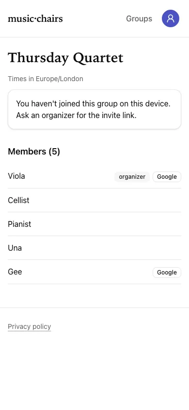 

Desktop: [light](images/routes-members-add-get--visitor--desktop-light.webp) · [dark](images/routes-members-add-get--visitor--desktop-dark.webp)

### routes/profile GET · to-group

- **When:** Someone opens the profile address itself
- **You see:** The group's page
- **Proved by:** the probe replayed in tests/error-states.test.tsx (answers every probe as the inventory says)

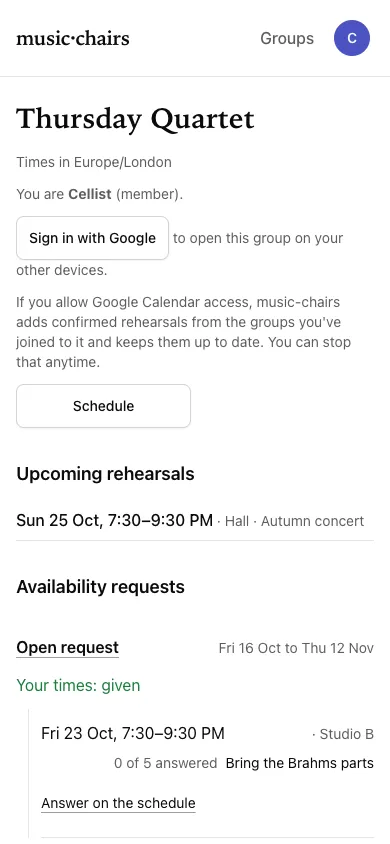 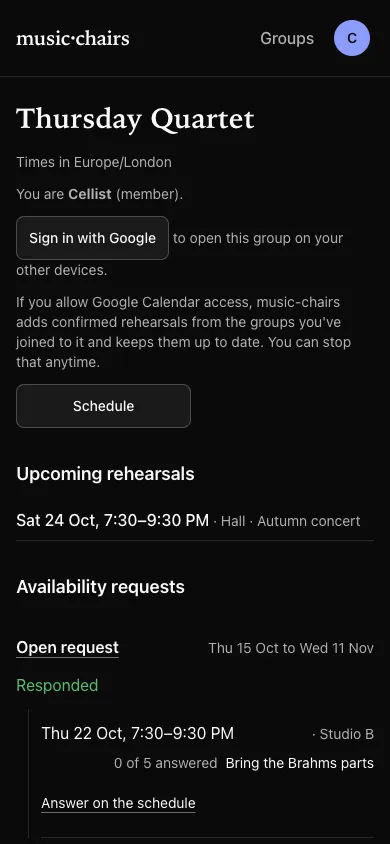

Desktop: [light](images/routes-profile-get--to-group--desktop-light.webp) · [dark](images/routes-profile-get--to-group--desktop-dark.webp)

### routes/rehearsal-link GET · unknown-group

- **When:** A link into a group that was deleted
- **You see:** The start page, saying “That link is out of date: what it pointed to was deleted or changed.”
- **Proved by:** the probe replayed in tests/error-states.test.tsx (answers every probe as the inventory says)

 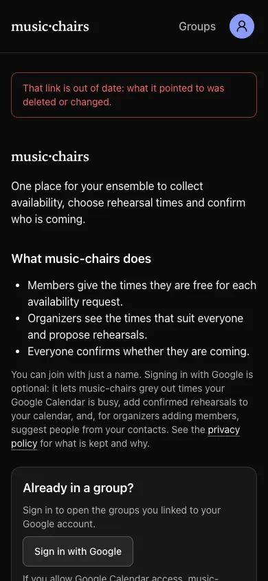

Desktop: [light](images/routes-rehearsal-link-get--unknown-group--desktop-light.webp) · [dark](images/routes-rehearsal-link-get--unknown-group--desktop-dark.webp)

### routes/rehearsal-link GET · unknown-rehearsal

- **When:** A link to a proposed time that was deleted
- **You see:** The schedule, saying “That link is out of date: what it pointed to was deleted or changed.”
- **Proved by:** the probe replayed in tests/error-states.test.tsx (answers every probe as the inventory says)

 

Desktop: [light](images/routes-rehearsal-link-get--unknown-rehearsal--desktop-light.webp) · [dark](images/routes-rehearsal-link-get--unknown-rehearsal--desktop-dark.webp)

### routes/rehearsal-link GET · unknown-request

- **When:** A link to a proposed time in a request that was deleted
- **You see:** The schedule, saying “That link is out of date: what it pointed to was deleted or changed.”
- **Proved by:** the probe replayed in tests/error-states.test.tsx (answers every probe as the inventory says)

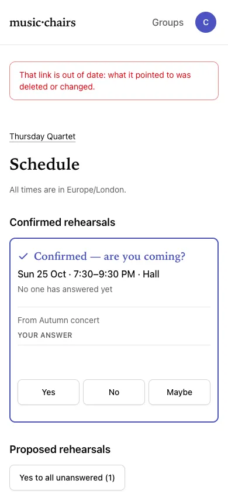 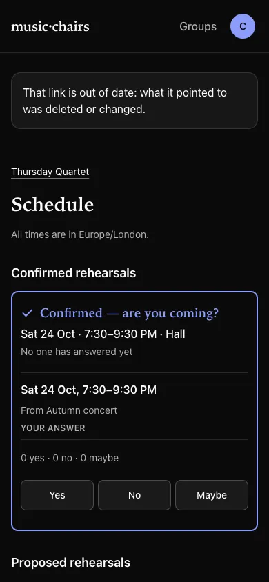

Desktop: [light](images/routes-rehearsal-link-get--unknown-request--desktop-light.webp) · [dark](images/routes-rehearsal-link-get--unknown-request--desktop-dark.webp)

### routes/request GET · clashes-access-removed

- **When:** Google refused the calendar access music-chairs had
- **You see:** “Google Calendar access was removed, so clashes can't be shown.” with Reconnect
- **Proved by:** tests/error-states.test.tsx: says Google Calendar access was removed, not that it was never given

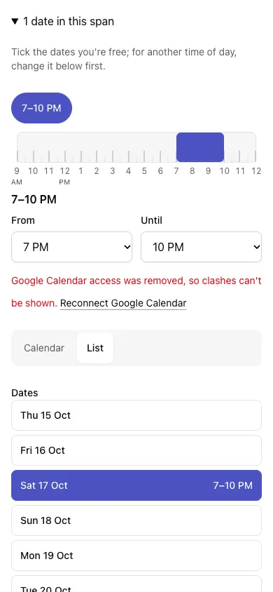 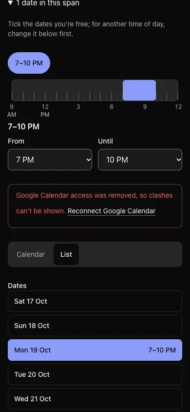

Desktop: [light](images/routes-request-get--clashes-access-removed--desktop-light.webp) · [dark](images/routes-request-get--clashes-access-removed--desktop-dark.webp)

### routes/request GET · clashes-unreadable

- **When:** Google Calendar can't be read for clashes (any error, or no answer within 5 seconds)
- **You see:** “Couldn't read your Google Calendar right now; nothing is greyed.” (in a first answer: every date ticked, check them)
- **Proved by:** tests/error-states.test.tsx: reads clashes whatever goes wrong, giving up after 5 seconds

 

Desktop: [light](images/routes-request-get--clashes-unreadable--desktop-light.webp) · [dark](images/routes-request-get--clashes-unreadable--desktop-dark.webp)

### routes/request GET · unknown-request

- **When:** The request was deleted, or the link is mistyped
- **You see:** “Page not found”
- **Proved by:** the probe replayed in tests/error-states.test.tsx (answers every probe as the inventory says)

 

Desktop: [light](images/routes-request-get--unknown-request--desktop-light.webp) · [dark](images/routes-request-get--unknown-request--desktop-dark.webp)

### routes/request GET · unreachable

- **When:** Moving to this page in the app while the connection is down, or the server errs
- **You see:** “Couldn't reach music-chairs” (or “Something went wrong on our side”) with Try again and the way back
- **Proved by:** tests/error-states.test.tsx: the error page names a missing page, an organizer-only page, our failure and a lost connection; browser gate: page load offline: the connection error page with Try again

 

Desktop: [light](images/routes-request-get--unreachable--desktop-light.webp) · [dark](images/routes-request-get--unreachable--desktop-dark.webp)

### routes/request GET · visitor

- **When:** Someone not in the group opens a request's address (the share link joins first)
- **You see:** The group's page, where they can join
- **Proved by:** the probe replayed in tests/error-states.test.tsx (answers every probe as the inventory says)

 

Desktop: [light](images/routes-request-get--visitor--desktop-light.webp) · [dark](images/routes-request-get--visitor--desktop-dark.webp)

### routes/request-calendar GET · not-ready

- **When:** The download is opened before the request's rehearsals are confirmed (only a link copied or kept from before: the page offers it once they are)
- **You see:** The request page, saying there's no calendar file yet (a browser told to download the link may save that page as a file instead)
- **Proved by:** the probe replayed in tests/error-states.test.tsx (answers every probe as the inventory says)

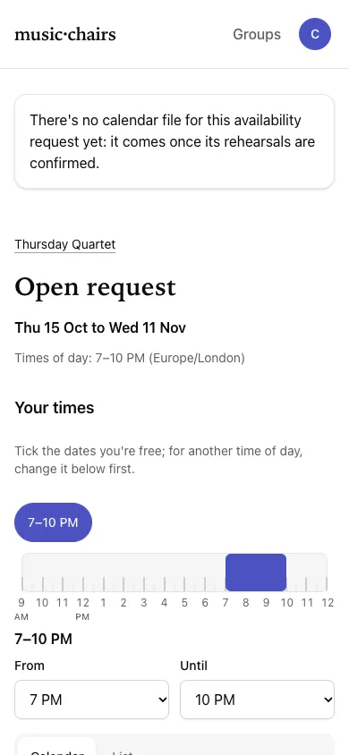 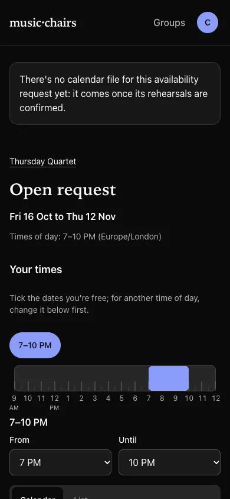

Desktop: [light](images/routes-request-calendar-get--not-ready--desktop-light.webp) · [dark](images/routes-request-calendar-get--not-ready--desktop-dark.webp)

### routes/request-calendar GET · unknown-group

- **When:** A download link into a group that was deleted
- **You see:** The start page, saying “That link is out of date: what it pointed to was deleted or changed.”
- **Proved by:** the probe replayed in tests/error-states.test.tsx (answers every probe as the inventory says)

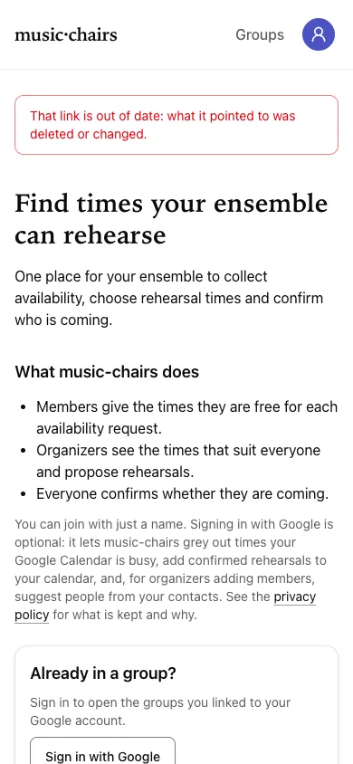 

Desktop: [light](images/routes-request-calendar-get--unknown-group--desktop-light.webp) · [dark](images/routes-request-calendar-get--unknown-group--desktop-dark.webp)

### routes/request-calendar GET · unknown-request

- **When:** A download link for a request that was deleted
- **You see:** The group's page, saying “That link is out of date: what it pointed to was deleted or changed.”
- **Proved by:** the probe replayed in tests/error-states.test.tsx (answers every probe as the inventory says)

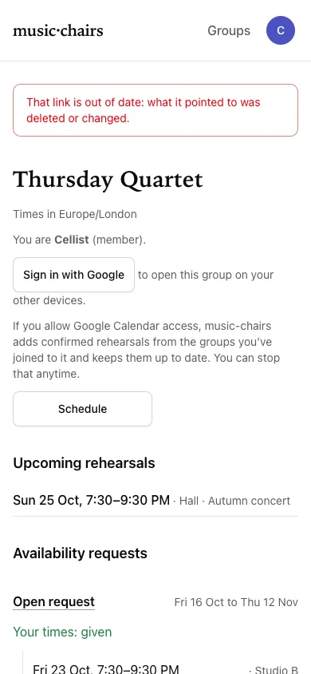 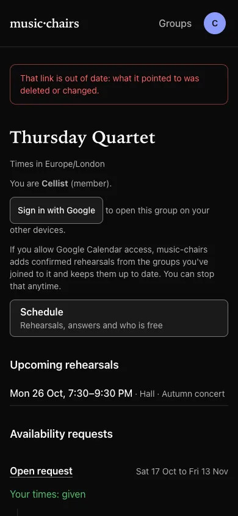

Desktop: [light](images/routes-request-calendar-get--unknown-request--desktop-light.webp) · [dark](images/routes-request-calendar-get--unknown-request--desktop-dark.webp)

### routes/request-calendar GET · visitor

- **When:** Someone this device isn't a member as opens it
- **You see:** The group's page, where they can join
- **Proved by:** the probe replayed in tests/error-states.test.tsx (answers every probe as the inventory says)

 

Desktop: [light](images/routes-request-calendar-get--visitor--desktop-light.webp) · [dark](images/routes-request-calendar-get--visitor--desktop-dark.webp)

### routes/requests.new GET · organizer-only

- **When:** A member who isn't an organizer asks (for example after losing the role)
- **You see:** “Only organizers can see this”, with the way back to the group
- **Proved by:** the probe replayed in tests/error-states.test.tsx (answers every probe as the inventory says)

 

Desktop: [light](images/routes-requests-new-get--organizer-only--desktop-light.webp) · [dark](images/routes-requests-new-get--organizer-only--desktop-dark.webp)

### routes/requests.new GET · unknown-edit

- **When:** Editing or repeating a request that no longer exists
- **You see:** “Page not found”
- **Proved by:** the probe replayed in tests/error-states.test.tsx (answers every probe as the inventory says)

 

Desktop: [light](images/routes-requests-new-get--unknown-edit--desktop-light.webp) · [dark](images/routes-requests-new-get--unknown-edit--desktop-dark.webp)

### routes/requests.new GET · unreachable

- **When:** Moving to this page in the app while the connection is down, or the server errs
- **You see:** “Couldn't reach music-chairs” (or “Something went wrong on our side”) with Try again and the way back
- **Proved by:** tests/error-states.test.tsx: the error page names a missing page, an organizer-only page, our failure and a lost connection; browser gate: page load offline: the connection error page with Try again

 

Desktop: [light](images/routes-requests-new-get--unreachable--desktop-light.webp) · [dark](images/routes-requests-new-get--unreachable--desktop-dark.webp)

### routes/requests.new GET · visitor

- **When:** Someone this device isn't a member as opens it
- **You see:** The group's page, where they can join
- **Proved by:** the probe replayed in tests/error-states.test.tsx (answers every probe as the inventory says)

 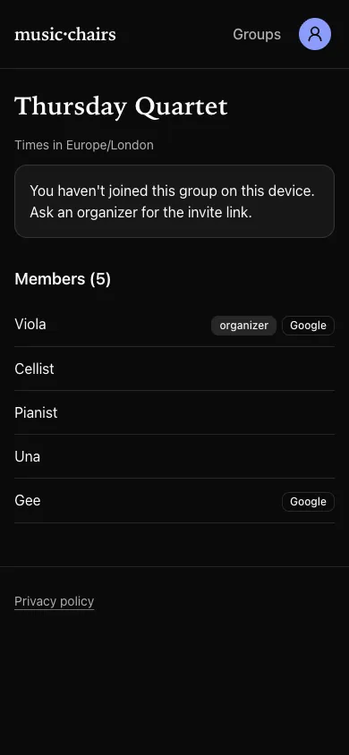

Desktop: [light](images/routes-requests-new-get--visitor--desktop-light.webp) · [dark](images/routes-requests-new-get--visitor--desktop-dark.webp)

### routes/schedule GET · calendar-access-removed

- **When:** Google refused the calendar access music-chairs had (removed at myaccount.google.com)
- **You see:** “Google Calendar access was removed” with Reconnect Google Calendar
- **Proved by:** tests/error-states.test.tsx: says Google Calendar access was removed, not that it was never given

 

Desktop: [light](images/routes-schedule-get--calendar-access-removed--desktop-light.webp) · [dark](images/routes-schedule-get--calendar-access-removed--desktop-dark.webp)

### routes/schedule GET · calendar-write-failed

- **When:** Google Calendar couldn't be updated the last time music-chairs tried
- **You see:** “Your Google Calendar couldn't be updated (last tried …)” in the calendar panel, to that member only
- **Proved by:** tests/error-states.test.tsx: shows a calendar that couldn't be updated to its member until an update works

 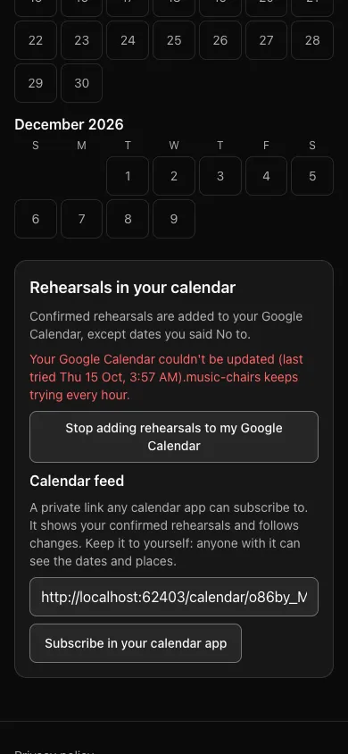

Desktop: [light](images/routes-schedule-get--calendar-write-failed--desktop-light.webp) · [dark](images/routes-schedule-get--calendar-write-failed--desktop-dark.webp)

### routes/schedule GET · unknown-group

- **When:** The group's address matches no group (deleted, or a mistyped link)
- **You see:** “Page not found”
- **Proved by:** the probe replayed in tests/error-states.test.tsx (answers every probe as the inventory says)

 

Desktop: [light](images/routes-schedule-get--unknown-group--desktop-light.webp) · [dark](images/routes-schedule-get--unknown-group--desktop-dark.webp)

### routes/schedule GET · unreachable

- **When:** Moving to this page in the app while the connection is down, or the server errs
- **You see:** “Couldn't reach music-chairs” (or “Something went wrong on our side”) with Try again and the way back
- **Proved by:** tests/error-states.test.tsx: the error page names a missing page, an organizer-only page, our failure and a lost connection; browser gate: page load offline: the connection error page with Try again

 

Desktop: [light](images/routes-schedule-get--unreachable--desktop-light.webp) · [dark](images/routes-schedule-get--unreachable--desktop-dark.webp)

### routes/schedule GET · visitor

- **When:** Someone this device isn't a member as opens it
- **You see:** The group's page, where they can join
- **Proved by:** the probe replayed in tests/error-states.test.tsx (answers every probe as the inventory says)

 

Desktop: [light](images/routes-schedule-get--visitor--desktop-light.webp) · [dark](images/routes-schedule-get--visitor--desktop-dark.webp)

## Saves on the start page

### routes/home POST (default) · browser-failure

- **When:** In the browser, the connection drops, the server answers with an error or doesn't answer within 20 seconds, or the thing was deleted or is organizer-only
- **You see:** “Maybe not saved.” and why, over the page, which stays as it was with what was typed, with Reload to check rather than Retry
- **Proved by:** tests/client-failure.test.ts: stays on the page as data, reloads nothing and never reaches the error page; tests/client-failure.test.ts: tells a thrown status, a lost connection, a crash and a redirect apart; tests/client-failure.test.ts: gives up waiting after 20 seconds and says the server didn't answer; tests/client-failure.test.ts: offers a reload to check, not a retry, for something that would be made twice; tests/error-states.test.tsx: a failed save says so with Retry, or Reload for a create; tests/error-states.test.tsx: keeps the last result while a failure shows, and lets a later result replace it

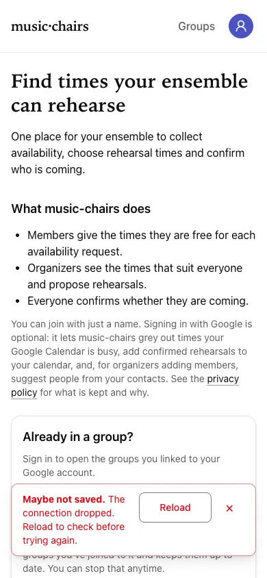 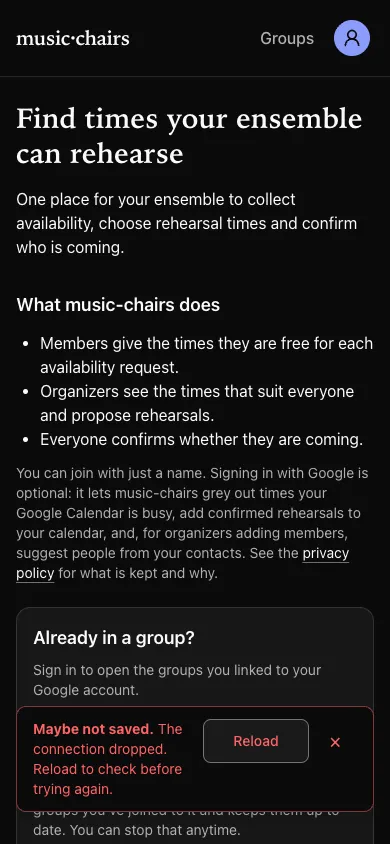

Desktop: [light](images/routes-home-post-default--browser-failure--desktop-light.webp) · [dark](images/routes-home-post-default--browser-failure--desktop-dark.webp)

### routes/home POST (default) · refused

- **When:** A group name, your name or the time zone is missing or too long
- **You see:** The form again with what was typed and the reason beside each field
- **Proved by:** the probe replayed in tests/error-states.test.tsx (answers every probe as the inventory says)

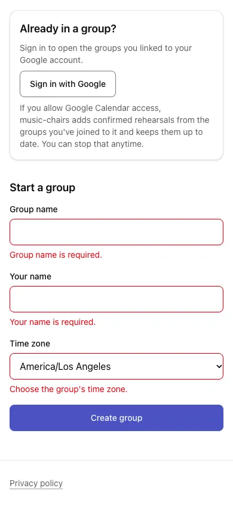 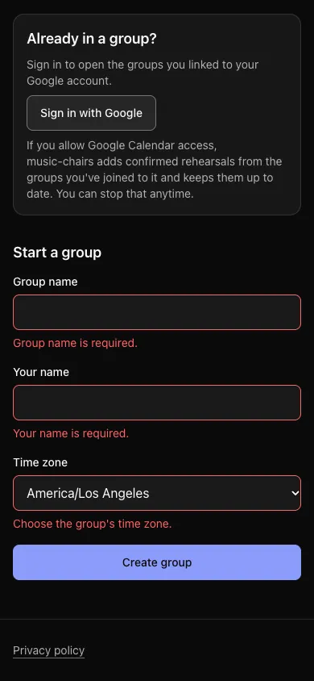

Desktop: [light](images/routes-home-post-default--refused--desktop-light.webp) · [dark](images/routes-home-post-default--refused--desktop-dark.webp)

## Saves on the groups page

### routes/groups POST (default) · browser-failure

- **When:** In the browser, the connection drops, the server answers with an error or doesn't answer within 20 seconds, or the thing was deleted or is organizer-only
- **You see:** “Maybe not saved.” and why, over the page, which stays as it was with what was typed, with Reload to check rather than Retry
- **Proved by:** tests/client-failure.test.ts: stays on the page as data, reloads nothing and never reaches the error page; tests/client-failure.test.ts: tells a thrown status, a lost connection, a crash and a redirect apart; tests/client-failure.test.ts: gives up waiting after 20 seconds and says the server didn't answer; tests/client-failure.test.ts: offers a reload to check, not a retry, for something that would be made twice; tests/error-states.test.tsx: a failed save says so with Retry, or Reload for a create; tests/error-states.test.tsx: keeps the last result while a failure shows, and lets a later result replace it

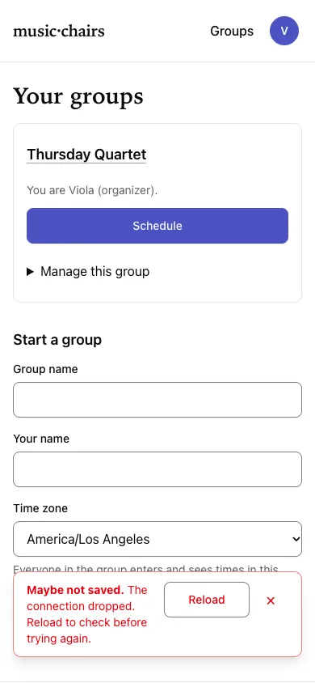 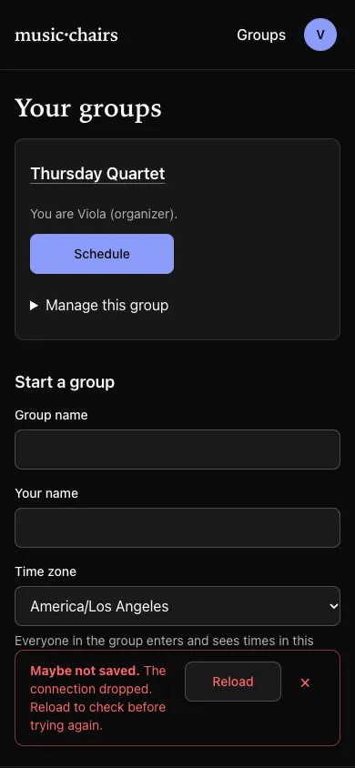

Desktop: [light](images/routes-groups-post-default--browser-failure--desktop-light.webp) · [dark](images/routes-groups-post-default--browser-failure--desktop-dark.webp)

### routes/groups POST (default) · refused

- **When:** A group name, your name or the time zone is missing or too long
- **You see:** The form again with what was typed and the reason beside each field
- **Proved by:** the probe replayed in tests/error-states.test.tsx (answers every probe as the inventory says)

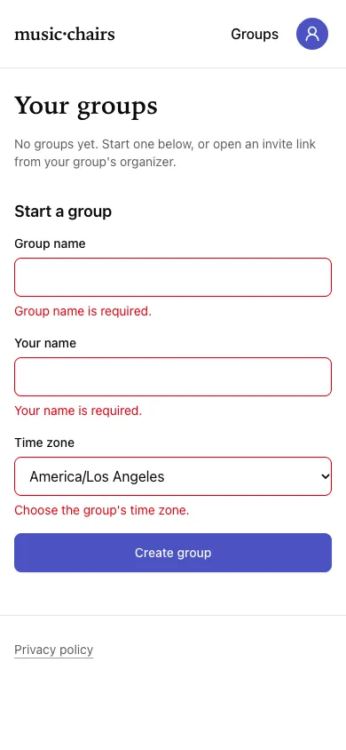 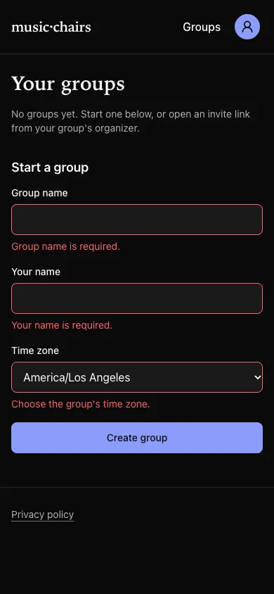

Desktop: [light](images/routes-groups-post-default--refused--desktop-light.webp) · [dark](images/routes-groups-post-default--refused--desktop-dark.webp)

## Saves on a group's page

### routes/group POST (default) · browser-failure

- **When:** In the browser, the connection drops, the server answers with an error or doesn't answer within 20 seconds, or the thing was deleted or is organizer-only
- **You see:** “Not saved.” or “Maybe not saved.” and why, over the page, which stays as it was with what was typed, with Retry (Reload when it was deleted or isn't theirs)
- **Proved by:** tests/client-failure.test.ts: stays on the page as data, reloads nothing and never reaches the error page; tests/client-failure.test.ts: tells a thrown status, a lost connection, a crash and a redirect apart; tests/client-failure.test.ts: gives up waiting after 20 seconds and says the server didn't answer; tests/error-states.test.tsx: a failed save says so with Retry, or Reload for a create; tests/error-states.test.tsx: keeps the last result while a failure shows, and lets a later result replace it

 

Desktop: [light](images/routes-group-post-default--browser-failure--desktop-light.webp) · [dark](images/routes-group-post-default--browser-failure--desktop-dark.webp)

### routes/group POST (default) · unknown-intent

- **When:** A form posts something this page doesn't do (an old page, or a tampered form)
- **You see:** “Something went wrong. Please try again.” at the top of the page
- **Proved by:** the probe replayed in tests/error-states.test.tsx (answers every probe as the inventory says)

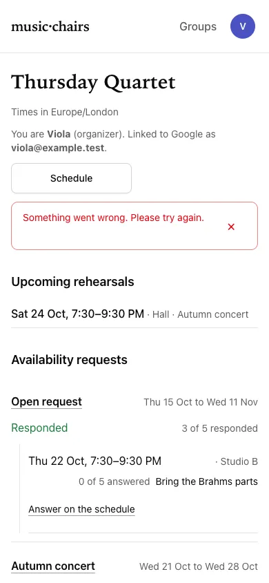 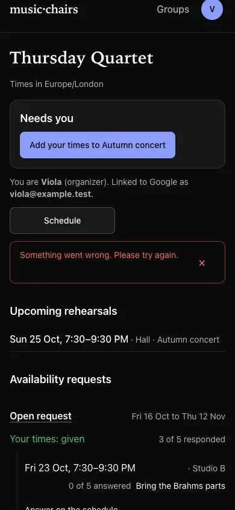

Desktop: [light](images/routes-group-post-default--unknown-intent--desktop-light.webp) · [dark](images/routes-group-post-default--unknown-intent--desktop-dark.webp)

### routes/group POST delete-group · browser-failure

- **When:** In the browser, the connection drops, the server answers with an error or doesn't answer within 20 seconds, or the thing was deleted or is organizer-only
- **You see:** “Not saved.” or “Maybe not saved.” and why, over the page, which stays as it was with what was typed, with Retry (Reload when it was deleted or isn't theirs)
- **Proved by:** tests/client-failure.test.ts: stays on the page as data, reloads nothing and never reaches the error page; tests/client-failure.test.ts: tells a thrown status, a lost connection, a crash and a redirect apart; tests/client-failure.test.ts: gives up waiting after 20 seconds and says the server didn't answer; tests/client-failure.test.ts: keeps a form posted to another page's action on the page it came from, as a fetcher; tests/error-states.test.tsx: keeps the last result while a failure shows, and lets a later result replace it

 

Desktop: [light](images/routes-group-post-delete-group--browser-failure--desktop-light.webp) · [dark](images/routes-group-post-delete-group--browser-failure--desktop-dark.webp)

### routes/group POST delete-group · organizer-only

- **When:** A member who isn't an organizer asks (for example after losing the role)
- **You see:** In the browser “Not saved. Only organizers can do that.”; without JavaScript “Only organizers can see this”
- **Proved by:** the probe replayed in tests/error-states.test.tsx (answers every probe as the inventory says)

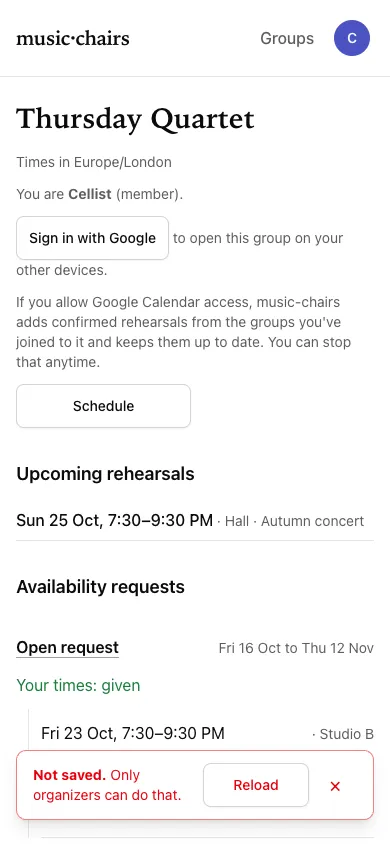 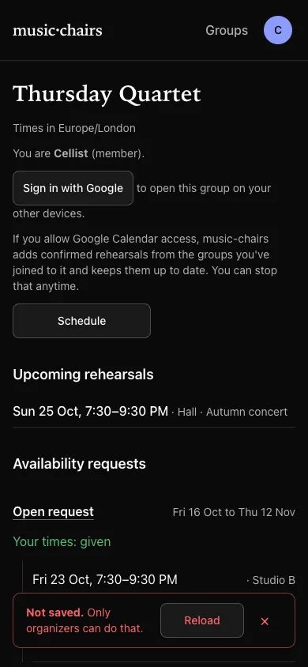

Desktop: [light](images/routes-group-post-delete-group--organizer-only--desktop-light.webp) · [dark](images/routes-group-post-delete-group--organizer-only--desktop-dark.webp)

### routes/group POST leave · browser-failure

- **When:** In the browser, the connection drops, the server answers with an error or doesn't answer within 20 seconds, or the thing was deleted or is organizer-only
- **You see:** “Not saved.” or “Maybe not saved.” and why, over the page, which stays as it was with what was typed, with Retry (Reload when it was deleted or isn't theirs)
- **Proved by:** tests/client-failure.test.ts: stays on the page as data, reloads nothing and never reaches the error page; tests/client-failure.test.ts: tells a thrown status, a lost connection, a crash and a redirect apart; tests/client-failure.test.ts: gives up waiting after 20 seconds and says the server didn't answer; tests/client-failure.test.ts: keeps a form posted to another page's action on the page it came from, as a fetcher; tests/error-states.test.tsx: keeps the last result while a failure shows, and lets a later result replace it

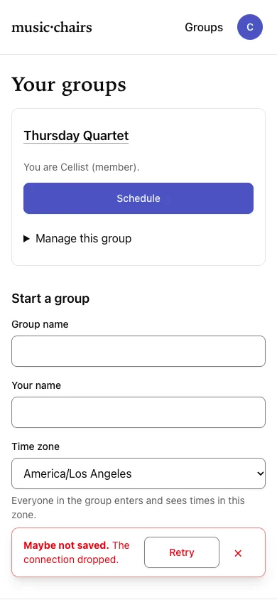 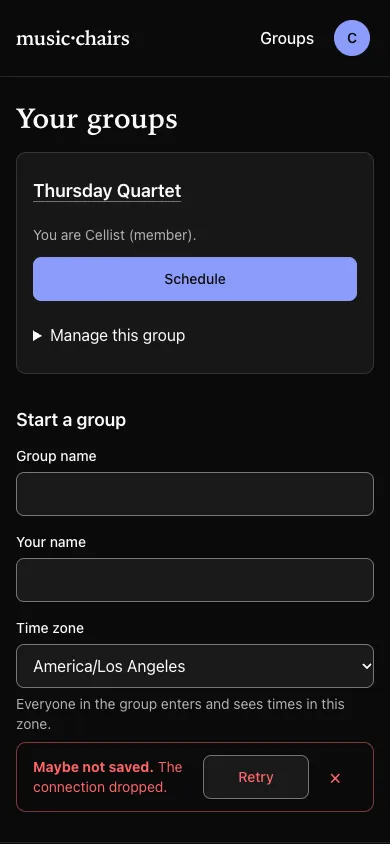

Desktop: [light](images/routes-group-post-leave--browser-failure--desktop-light.webp) · [dark](images/routes-group-post-leave--browser-failure--desktop-dark.webp)

### routes/group POST leave · last-organizer

- **When:** The only organizer tries to leave
- **You see:** Why they can't, at the top of the page
- **Proved by:** the probe replayed in tests/error-states.test.tsx (answers every probe as the inventory says)

 

Desktop: [light](images/routes-group-post-leave--last-organizer--desktop-light.webp) · [dark](images/routes-group-post-leave--last-organizer--desktop-dark.webp)

### routes/group POST leave · last-organizer-from-groups

- **When:** The same, from the groups page
- **You see:** Back on the groups page with the reason in an error toast
- **Proved by:** the probe replayed in tests/error-states.test.tsx (answers every probe as the inventory says)

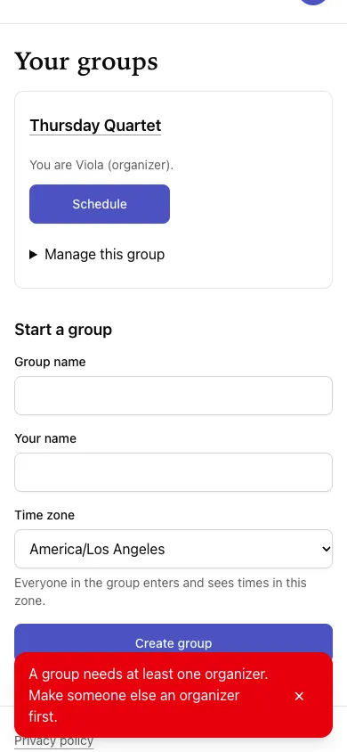 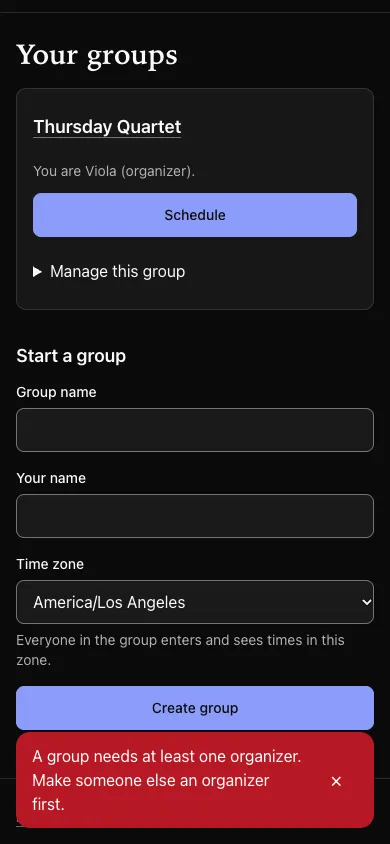

Desktop: [light](images/routes-group-post-leave--last-organizer-from-groups--desktop-light.webp) · [dark](images/routes-group-post-leave--last-organizer-from-groups--desktop-dark.webp)

### routes/group POST remove-member · browser-failure

- **When:** In the browser, the connection drops, the server answers with an error or doesn't answer within 20 seconds, or the thing was deleted or is organizer-only
- **You see:** “Not saved.” or “Maybe not saved.” and why, over the page, which stays as it was with what was typed, with Retry (Reload when it was deleted or isn't theirs)
- **Proved by:** tests/client-failure.test.ts: stays on the page as data, reloads nothing and never reaches the error page; tests/client-failure.test.ts: tells a thrown status, a lost connection, a crash and a redirect apart; tests/client-failure.test.ts: gives up waiting after 20 seconds and says the server didn't answer; tests/error-states.test.tsx: a failed save says so with Retry, or Reload for a create; tests/error-states.test.tsx: keeps the last result while a failure shows, and lets a later result replace it

 

Desktop: [light](images/routes-group-post-remove-member--browser-failure--desktop-light.webp) · [dark](images/routes-group-post-remove-member--browser-failure--desktop-dark.webp)

### routes/group POST remove-member · last-organizer

- **When:** Removing the only organizer
- **You see:** Why not, at the top of the page
- **Proved by:** the probe replayed in tests/error-states.test.tsx (answers every probe as the inventory says)

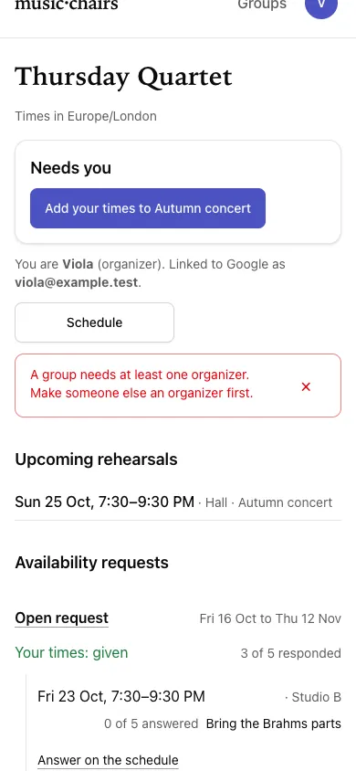 

Desktop: [light](images/routes-group-post-remove-member--last-organizer--desktop-light.webp) · [dark](images/routes-group-post-remove-member--last-organizer--desktop-dark.webp)

### routes/group POST remove-member · unknown-member

- **When:** The member was removed meanwhile
- **You see:** “Not saved. This was deleted or changed …”
- **Proved by:** the probe replayed in tests/error-states.test.tsx (answers every probe as the inventory says)

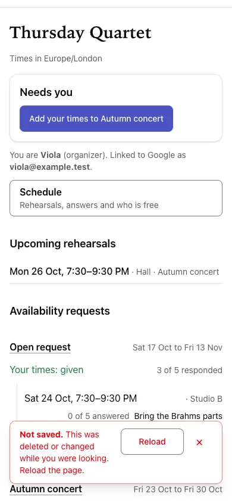 

Desktop: [light](images/routes-group-post-remove-member--unknown-member--desktop-light.webp) · [dark](images/routes-group-post-remove-member--unknown-member--desktop-dark.webp)

### routes/group POST rename-member · browser-failure

- **When:** In the browser, the connection drops, the server answers with an error or doesn't answer within 20 seconds, or the thing was deleted or is organizer-only
- **You see:** “Not saved.” or “Maybe not saved.” and why, over the page, which stays as it was with what was typed, with Retry (Reload when it was deleted or isn't theirs)
- **Proved by:** tests/client-failure.test.ts: stays on the page as data, reloads nothing and never reaches the error page; tests/client-failure.test.ts: tells a thrown status, a lost connection, a crash and a redirect apart; tests/client-failure.test.ts: gives up waiting after 20 seconds and says the server didn't answer; tests/error-states.test.tsx: a failed save says so with Retry, or Reload for a create; tests/error-states.test.tsx: keeps the last result while a failure shows, and lets a later result replace it

 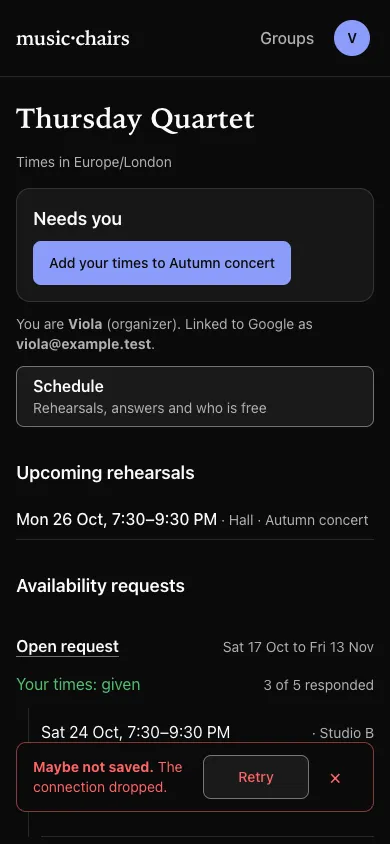

Desktop: [light](images/routes-group-post-rename-member--browser-failure--desktop-light.webp) · [dark](images/routes-group-post-rename-member--browser-failure--desktop-dark.webp)

### routes/group POST rename-member · refused

- **When:** The new name is empty or too long
- **You see:** Why, at the top of the page
- **Proved by:** the probe replayed in tests/error-states.test.tsx (answers every probe as the inventory says)

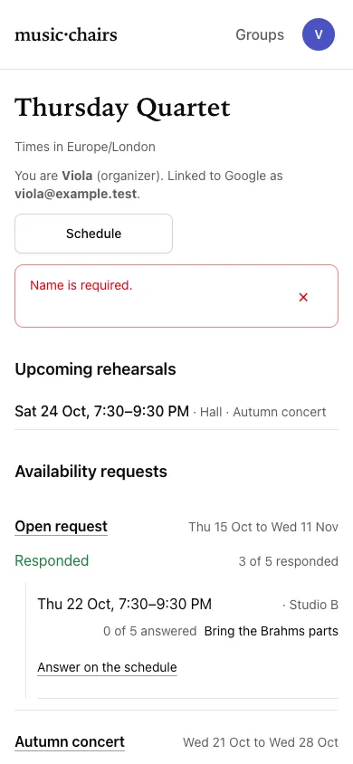 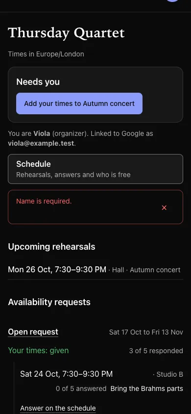

Desktop: [light](images/routes-group-post-rename-member--refused--desktop-light.webp) · [dark](images/routes-group-post-rename-member--refused--desktop-dark.webp)

### routes/group POST rename-member · unknown-member

- **When:** The member was removed meanwhile
- **You see:** “Not saved. This was deleted or changed …”
- **Proved by:** the probe replayed in tests/error-states.test.tsx (answers every probe as the inventory says)

 

Desktop: [light](images/routes-group-post-rename-member--unknown-member--desktop-light.webp) · [dark](images/routes-group-post-rename-member--unknown-member--desktop-dark.webp)

### routes/group POST set-optional · browser-failure

- **When:** In the browser, the connection drops, the server answers with an error or doesn't answer within 20 seconds, or the thing was deleted or is organizer-only
- **You see:** “Not saved.” or “Maybe not saved.” and why, over the page, which stays as it was with what was typed, with Retry (Reload when it was deleted or isn't theirs)
- **Proved by:** tests/client-failure.test.ts: stays on the page as data, reloads nothing and never reaches the error page; tests/client-failure.test.ts: tells a thrown status, a lost connection, a crash and a redirect apart; tests/client-failure.test.ts: gives up waiting after 20 seconds and says the server didn't answer; tests/error-states.test.tsx: a failed save says so with Retry, or Reload for a create; tests/error-states.test.tsx: keeps the last result while a failure shows, and lets a later result replace it

 

Desktop: [light](images/routes-group-post-set-optional--browser-failure--desktop-light.webp) · [dark](images/routes-group-post-set-optional--browser-failure--desktop-dark.webp)

### routes/group POST set-optional · unknown-member

- **When:** The member was removed meanwhile
- **You see:** In the browser “Not saved. This was deleted or changed …” with Reload
- **Proved by:** the probe replayed in tests/error-states.test.tsx (answers every probe as the inventory says)

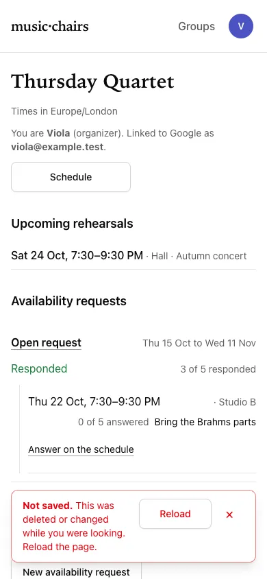 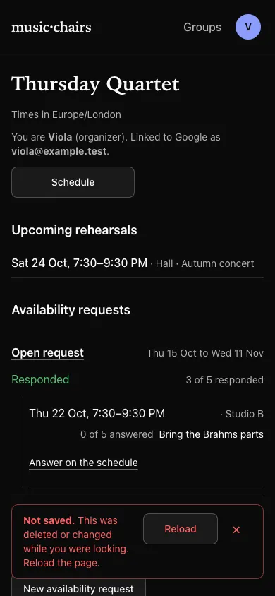

Desktop: [light](images/routes-group-post-set-optional--unknown-member--desktop-light.webp) · [dark](images/routes-group-post-set-optional--unknown-member--desktop-dark.webp)

### routes/group POST set-privacy · browser-failure

- **When:** In the browser, the connection drops, the server answers with an error or doesn't answer within 20 seconds, or the thing was deleted or is organizer-only
- **You see:** “Not saved.” or “Maybe not saved.” and why, over the page, which stays as it was with what was typed, with Retry (Reload when it was deleted or isn't theirs)
- **Proved by:** tests/client-failure.test.ts: stays on the page as data, reloads nothing and never reaches the error page; tests/client-failure.test.ts: tells a thrown status, a lost connection, a crash and a redirect apart; tests/client-failure.test.ts: gives up waiting after 20 seconds and says the server didn't answer; tests/error-states.test.tsx: a failed save says so with Retry, or Reload for a create; tests/error-states.test.tsx: keeps the last result while a failure shows, and lets a later result replace it

 

Desktop: [light](images/routes-group-post-set-privacy--browser-failure--desktop-light.webp) · [dark](images/routes-group-post-set-privacy--browser-failure--desktop-dark.webp)

### routes/group POST set-privacy · organizer-only

- **When:** A member who isn't an organizer asks (for example after losing the role)
- **You see:** In the browser “Not saved. Only organizers can do that.”; without JavaScript “Only organizers can see this”
- **Proved by:** the probe replayed in tests/error-states.test.tsx (answers every probe as the inventory says)

 

Desktop: [light](images/routes-group-post-set-privacy--organizer-only--desktop-light.webp) · [dark](images/routes-group-post-set-privacy--organizer-only--desktop-dark.webp)

### routes/group POST set-role · browser-failure

- **When:** In the browser, the connection drops, the server answers with an error or doesn't answer within 20 seconds, or the thing was deleted or is organizer-only
- **You see:** “Not saved.” or “Maybe not saved.” and why, over the page, which stays as it was with what was typed, with Retry (Reload when it was deleted or isn't theirs)
- **Proved by:** tests/client-failure.test.ts: stays on the page as data, reloads nothing and never reaches the error page; tests/client-failure.test.ts: tells a thrown status, a lost connection, a crash and a redirect apart; tests/client-failure.test.ts: gives up waiting after 20 seconds and says the server didn't answer; tests/error-states.test.tsx: a failed save says so with Retry, or Reload for a create; tests/error-states.test.tsx: keeps the last result while a failure shows, and lets a later result replace it

 

Desktop: [light](images/routes-group-post-set-role--browser-failure--desktop-light.webp) · [dark](images/routes-group-post-set-role--browser-failure--desktop-dark.webp)

### routes/group POST set-role · last-organizer

- **When:** Removing the only organizer's role
- **You see:** Why not, at the top of the page
- **Proved by:** the probe replayed in tests/error-states.test.tsx (answers every probe as the inventory says)

 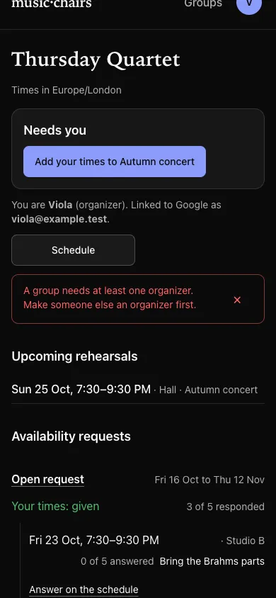

Desktop: [light](images/routes-group-post-set-role--last-organizer--desktop-light.webp) · [dark](images/routes-group-post-set-role--last-organizer--desktop-dark.webp)

### routes/group POST set-role · unknown-member

- **When:** The member was removed meanwhile
- **You see:** “Not saved. This was deleted or changed …”
- **Proved by:** the probe replayed in tests/error-states.test.tsx (answers every probe as the inventory says)

 

Desktop: [light](images/routes-group-post-set-role--unknown-member--desktop-light.webp) · [dark](images/routes-group-post-set-role--unknown-member--desktop-dark.webp)

### routes/group POST update-group · browser-failure

- **When:** In the browser, the connection drops, the server answers with an error or doesn't answer within 20 seconds, or the thing was deleted or is organizer-only
- **You see:** “Not saved.” or “Maybe not saved.” and why, over the page, which stays as it was with what was typed, with Retry (Reload when it was deleted or isn't theirs)
- **Proved by:** tests/client-failure.test.ts: stays on the page as data, reloads nothing and never reaches the error page; tests/client-failure.test.ts: tells a thrown status, a lost connection, a crash and a redirect apart; tests/client-failure.test.ts: gives up waiting after 20 seconds and says the server didn't answer; tests/error-states.test.tsx: a failed save says so with Retry, or Reload for a create; tests/error-states.test.tsx: keeps the last result while a failure shows, and lets a later result replace it

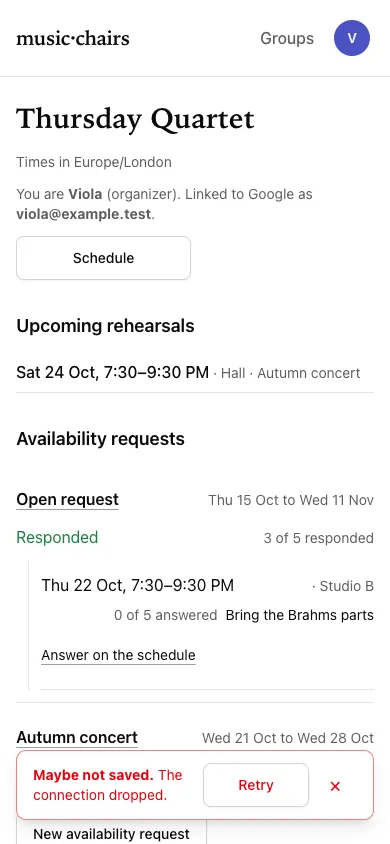 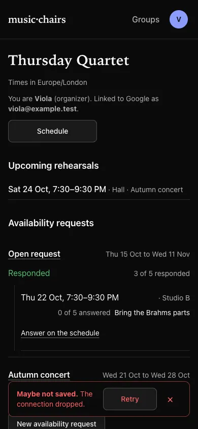

Desktop: [light](images/routes-group-post-update-group--browser-failure--desktop-light.webp) · [dark](images/routes-group-post-update-group--browser-failure--desktop-dark.webp)

### routes/group POST update-group · organizer-only

- **When:** A member who isn't an organizer asks (for example after losing the role)
- **You see:** In the browser “Not saved. Only organizers can do that.”; without JavaScript “Only organizers can see this”
- **Proved by:** the probe replayed in tests/error-states.test.tsx (answers every probe as the inventory says)

 

Desktop: [light](images/routes-group-post-update-group--organizer-only--desktop-light.webp) · [dark](images/routes-group-post-update-group--organizer-only--desktop-dark.webp)

### routes/group POST update-group · refused

- **When:** The new name is empty or too long
- **You see:** The settings form with the reason beside the name
- **Proved by:** the probe replayed in tests/error-states.test.tsx (answers every probe as the inventory says)

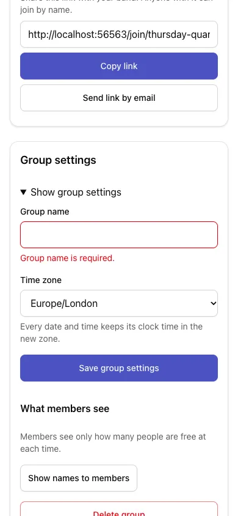 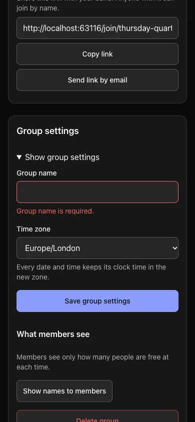

Desktop: [light](images/routes-group-post-update-group--refused--desktop-light.webp) · [dark](images/routes-group-post-update-group--refused--desktop-dark.webp)

### routes/group POST update-group · refused-from-groups

- **When:** The same, renamed from the groups page
- **You see:** Back on the groups page with the reason in an error toast
- **Proved by:** the probe replayed in tests/error-states.test.tsx (answers every probe as the inventory says)

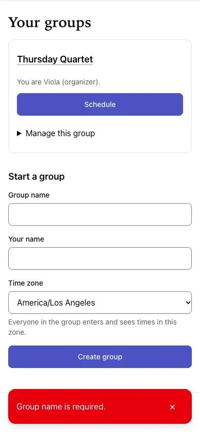 

Desktop: [light](images/routes-group-post-update-group--refused-from-groups--desktop-light.webp) · [dark](images/routes-group-post-update-group--refused-from-groups--desktop-dark.webp)

## Saves on the schedule

### routes/schedule POST (default) · browser-failure

- **When:** In the browser, the connection drops, the server answers with an error or doesn't answer within 20 seconds, or the thing was deleted or is organizer-only
- **You see:** “Not saved.” or “Maybe not saved.” and why, over the page, which stays as it was with what was typed, with Retry (Reload when it was deleted or isn't theirs)
- **Proved by:** tests/client-failure.test.ts: stays on the page as data, reloads nothing and never reaches the error page; tests/client-failure.test.ts: tells a thrown status, a lost connection, a crash and a redirect apart; tests/client-failure.test.ts: gives up waiting after 20 seconds and says the server didn't answer; tests/error-states.test.tsx: a failed save says so with Retry, or Reload for a create; tests/error-states.test.tsx: keeps the last result while a failure shows, and lets a later result replace it

 

Desktop: [light](images/routes-schedule-post-default--browser-failure--desktop-light.webp) · [dark](images/routes-schedule-post-default--browser-failure--desktop-dark.webp)

### routes/schedule POST (default) · unknown-intent

- **When:** A form posts something this page doesn't do (an old page, or a tampered form)
- **You see:** “Something went wrong. Please try again.” at the top of the page
- **Proved by:** the probe replayed in tests/error-states.test.tsx (answers every probe as the inventory says)

 

Desktop: [light](images/routes-schedule-post-default--unknown-intent--desktop-light.webp) · [dark](images/routes-schedule-post-default--unknown-intent--desktop-dark.webp)

### routes/schedule POST confirm · browser-failure

- **When:** In the browser, the connection drops, the server answers with an error or doesn't answer within 20 seconds, or the thing was deleted or is organizer-only
- **You see:** “Not saved.” or “Maybe not saved.” and why, over the page, which stays as it was with what was typed, with Retry (Reload when it was deleted or isn't theirs)
- **Proved by:** tests/client-failure.test.ts: stays on the page as data, reloads nothing and never reaches the error page; tests/client-failure.test.ts: tells a thrown status, a lost connection, a crash and a redirect apart; tests/client-failure.test.ts: gives up waiting after 20 seconds and says the server didn't answer; tests/error-states.test.tsx: a failed save says so with Retry, or Reload for a create; tests/error-states.test.tsx: keeps the last result while a failure shows, and lets a later result replace it

 

Desktop: [light](images/routes-schedule-post-confirm--browser-failure--desktop-light.webp) · [dark](images/routes-schedule-post-confirm--browser-failure--desktop-dark.webp)

### routes/schedule POST confirm · organizer-only

- **When:** A member who isn't an organizer asks (for example after losing the role)
- **You see:** In the browser “Not saved. Only organizers can do that.”; without JavaScript “Only organizers can see this”
- **Proved by:** the probe replayed in tests/error-states.test.tsx (answers every probe as the inventory says)

 

Desktop: [light](images/routes-schedule-post-confirm--organizer-only--desktop-light.webp) · [dark](images/routes-schedule-post-confirm--organizer-only--desktop-dark.webp)

### routes/schedule POST confirm · unknown-rehearsal

- **When:** The proposed time was deleted meanwhile
- **You see:** “Not saved. This was deleted or changed …”
- **Proved by:** the probe replayed in tests/error-states.test.tsx (answers every probe as the inventory says)

 

Desktop: [light](images/routes-schedule-post-confirm--unknown-rehearsal--desktop-light.webp) · [dark](images/routes-schedule-post-confirm--unknown-rehearsal--desktop-dark.webp)

### routes/schedule POST delete · browser-failure

- **When:** In the browser, the connection drops, the server answers with an error or doesn't answer within 20 seconds, or the thing was deleted or is organizer-only
- **You see:** “Not saved.” or “Maybe not saved.” and why, over the page, which stays as it was with what was typed, with Retry (Reload when it was deleted or isn't theirs)
- **Proved by:** tests/client-failure.test.ts: stays on the page as data, reloads nothing and never reaches the error page; tests/client-failure.test.ts: tells a thrown status, a lost connection, a crash and a redirect apart; tests/client-failure.test.ts: gives up waiting after 20 seconds and says the server didn't answer; tests/error-states.test.tsx: a failed save says so with Retry, or Reload for a create; tests/error-states.test.tsx: keeps the last result while a failure shows, and lets a later result replace it

 

Desktop: [light](images/routes-schedule-post-delete--browser-failure--desktop-light.webp) · [dark](images/routes-schedule-post-delete--browser-failure--desktop-dark.webp)

### routes/schedule POST delete · organizer-only

- **When:** A member who isn't an organizer asks (for example after losing the role)
- **You see:** In the browser “Not saved. Only organizers can do that.”; without JavaScript “Only organizers can see this”
- **Proved by:** the probe replayed in tests/error-states.test.tsx (answers every probe as the inventory says)

 

Desktop: [light](images/routes-schedule-post-delete--organizer-only--desktop-light.webp) · [dark](images/routes-schedule-post-delete--organizer-only--desktop-dark.webp)

### routes/schedule POST delete · unknown-rehearsal

- **When:** Already deleted
- **You see:** “Not saved. This was deleted or changed …”
- **Proved by:** the probe replayed in tests/error-states.test.tsx (answers every probe as the inventory says)

 

Desktop: [light](images/routes-schedule-post-delete--unknown-rehearsal--desktop-light.webp) · [dark](images/routes-schedule-post-delete--unknown-rehearsal--desktop-dark.webp)

### routes/schedule POST notes · browser-failure

- **When:** In the browser, the connection drops, the server answers with an error or doesn't answer within 20 seconds, or the thing was deleted or is organizer-only
- **You see:** “Not saved.” or “Maybe not saved.” and why, over the page, which stays as it was with what was typed, with Retry (Reload when it was deleted or isn't theirs)
- **Proved by:** tests/client-failure.test.ts: stays on the page as data, reloads nothing and never reaches the error page; tests/client-failure.test.ts: tells a thrown status, a lost connection, a crash and a redirect apart; tests/client-failure.test.ts: gives up waiting after 20 seconds and says the server didn't answer; tests/error-states.test.tsx: a failed save says so with Retry, or Reload for a create; tests/error-states.test.tsx: keeps the last result while a failure shows, and lets a later result replace it

 

Desktop: [light](images/routes-schedule-post-notes--browser-failure--desktop-light.webp) · [dark](images/routes-schedule-post-notes--browser-failure--desktop-dark.webp)

### routes/schedule POST notes · refused

- **When:** Notes longer than 1,000 characters
- **You see:** Why, at the top of the schedule
- **Proved by:** the probe replayed in tests/error-states.test.tsx (answers every probe as the inventory says)

 

Desktop: [light](images/routes-schedule-post-notes--refused--desktop-light.webp) · [dark](images/routes-schedule-post-notes--refused--desktop-dark.webp)

### routes/schedule POST rsvp · browser-failure

- **When:** In the browser, the connection drops, the server answers with an error or doesn't answer within 20 seconds, or the thing was deleted or is organizer-only
- **You see:** “Not saved.” or “Maybe not saved.” and why, over the page, which stays as it was with what was typed, with Retry (Reload when it was deleted or isn't theirs)
- **Proved by:** tests/client-failure.test.ts: stays on the page as data, reloads nothing and never reaches the error page; tests/client-failure.test.ts: tells a thrown status, a lost connection, a crash and a redirect apart; tests/client-failure.test.ts: gives up waiting after 20 seconds and says the server didn't answer; tests/error-states.test.tsx: a failed save says so with Retry, or Reload for a create; tests/error-states.test.tsx: keeps the last result while a failure shows, and lets a later result replace it

 

Desktop: [light](images/routes-schedule-post-rsvp--browser-failure--desktop-light.webp) · [dark](images/routes-schedule-post-rsvp--browser-failure--desktop-dark.webp)

### routes/schedule POST rsvp · no-answer

- **When:** An answer is saved and the server doesn't answer within 20 seconds
- **You see:** “Maybe not saved.” and “The server didn't answer in time.”, with Retry
- **Proved by:** tests/client-failure.test.ts: tells a thrown status, a lost connection, a crash and a redirect apart

 

Desktop: [light](images/routes-schedule-post-rsvp--no-answer--desktop-light.webp) · [dark](images/routes-schedule-post-rsvp--no-answer--desktop-dark.webp)

### routes/schedule POST rsvp · refused

- **When:** Not yes, no or maybe (a tampered form)
- **You see:** Why, at the top of the schedule
- **Proved by:** the probe replayed in tests/error-states.test.tsx (answers every probe as the inventory says)

 

Desktop: [light](images/routes-schedule-post-rsvp--refused--desktop-light.webp) · [dark](images/routes-schedule-post-rsvp--refused--desktop-dark.webp)

### routes/schedule POST rsvp · server-error

- **When:** An answer is saved while a gateway in front of the app answers with an error
- **You see:** “Maybe not saved.” and “Something went wrong on our side.”, with Retry
- **Proved by:** tests/client-failure.test.ts: tells a thrown status, a lost connection, a crash and a redirect apart

 

Desktop: [light](images/routes-schedule-post-rsvp--server-error--desktop-light.webp) · [dark](images/routes-schedule-post-rsvp--server-error--desktop-dark.webp)

### routes/schedule POST rsvp · unknown-rehearsal

- **When:** The proposed time was deleted meanwhile
- **You see:** “Not saved. This was deleted or changed …” with Reload
- **Proved by:** the probe replayed in tests/error-states.test.tsx (answers every probe as the inventory says)

 

Desktop: [light](images/routes-schedule-post-rsvp--unknown-rehearsal--desktop-light.webp) · [dark](images/routes-schedule-post-rsvp--unknown-rehearsal--desktop-dark.webp)

### routes/schedule POST set-calendar · browser-failure

- **When:** In the browser, the connection drops, the server answers with an error or doesn't answer within 20 seconds, or the thing was deleted or is organizer-only
- **You see:** “Not saved.” or “Maybe not saved.” and why, over the page, which stays as it was with what was typed, with Retry (Reload when it was deleted or isn't theirs)
- **Proved by:** tests/client-failure.test.ts: stays on the page as data, reloads nothing and never reaches the error page; tests/client-failure.test.ts: tells a thrown status, a lost connection, a crash and a redirect apart; tests/client-failure.test.ts: gives up waiting after 20 seconds and says the server didn't answer; tests/error-states.test.tsx: a failed save says so with Retry, or Reload for a create; tests/error-states.test.tsx: keeps the last result while a failure shows, and lets a later result replace it

 

Desktop: [light](images/routes-schedule-post-set-calendar--browser-failure--desktop-light.webp) · [dark](images/routes-schedule-post-set-calendar--browser-failure--desktop-dark.webp)

### routes/schedule POST set-calendar · browser-failure-from-home

- **When:** In the browser, the connection drops, the server answers with an error or doesn't answer within 20 seconds, or the thing was deleted or is organizer-only
- **You see:** “Not saved.” or “Maybe not saved.” and why, over the page, which stays as it was with what was typed, with Retry (Reload when it was deleted or isn't theirs)
- **Proved by:** tests/client-failure.test.ts: stays on the page as data, reloads nothing and never reaches the error page; tests/client-failure.test.ts: tells a thrown status, a lost connection, a crash and a redirect apart; tests/client-failure.test.ts: gives up waiting after 20 seconds and says the server didn't answer; tests/client-failure.test.ts: keeps a form posted to another page's action on the page it came from, as a fetcher; tests/error-states.test.tsx: keeps the last result while a failure shows, and lets a later result replace it

 

Desktop: [light](images/routes-schedule-post-set-calendar--browser-failure-from-home--desktop-light.webp) · [dark](images/routes-schedule-post-set-calendar--browser-failure-from-home--desktop-dark.webp)

### routes/schedule POST set-calendar · not-connected

- **When:** Google Calendar isn't connected (any more)
- **You see:** “Connect Google Calendar first.” at the top of the schedule
- **Proved by:** the probe replayed in tests/error-states.test.tsx (answers every probe as the inventory says)

 

Desktop: [light](images/routes-schedule-post-set-calendar--not-connected--desktop-light.webp) · [dark](images/routes-schedule-post-set-calendar--not-connected--desktop-dark.webp)

### routes/schedule POST set-calendar · not-connected-from-home

- **When:** The same, from the start page
- **You see:** Back on the start page with the reason in an error toast
- **Proved by:** the probe replayed in tests/error-states.test.tsx (answers every probe as the inventory says)

 

Desktop: [light](images/routes-schedule-post-set-calendar--not-connected-from-home--desktop-light.webp) · [dark](images/routes-schedule-post-set-calendar--not-connected-from-home--desktop-dark.webp)

## Saves on an availability request

### routes/request POST (default) · browser-failure

- **When:** In the browser, the connection drops, the server answers with an error or doesn't answer within 20 seconds, or the thing was deleted or is organizer-only
- **You see:** “Not saved.” or “Maybe not saved.” and why, over the page, which stays as it was with what was typed, with Retry (Reload when it was deleted or isn't theirs)
- **Proved by:** tests/client-failure.test.ts: stays on the page as data, reloads nothing and never reaches the error page; tests/client-failure.test.ts: tells a thrown status, a lost connection, a crash and a redirect apart; tests/client-failure.test.ts: gives up waiting after 20 seconds and says the server didn't answer; tests/error-states.test.tsx: a failed save says so with Retry, or Reload for a create; tests/error-states.test.tsx: keeps the last result while a failure shows, and lets a later result replace it

 

Desktop: [light](images/routes-request-post-default--browser-failure--desktop-light.webp) · [dark](images/routes-request-post-default--browser-failure--desktop-dark.webp)

### routes/request POST (default) · unknown-intent

- **When:** A form posts something this page doesn't do (an old page, or a tampered form)
- **You see:** “Something went wrong. Please try again.” at the top of the page
- **Proved by:** the probe replayed in tests/error-states.test.tsx (answers every probe as the inventory says)

 

Desktop: [light](images/routes-request-post-default--unknown-intent--desktop-light.webp) · [dark](images/routes-request-post-default--unknown-intent--desktop-dark.webp)

### routes/request POST answer · browser-failure

- **When:** In the browser, the connection drops, the server answers with an error or doesn't answer within 20 seconds, or the thing was deleted or is organizer-only
- **You see:** “Not saved.” or “Maybe not saved.” and why, beside the control, which keeps the change, with Retry (Reload when it was deleted or isn't theirs)
- **Proved by:** tests/client-failure.test.ts: stays on the page as data, reloads nothing and never reaches the error page; tests/client-failure.test.ts: tells a thrown status, a lost connection, a crash and a redirect apart; tests/client-failure.test.ts: gives up waiting after 20 seconds and says the server didn't answer; tests/error-states.test.tsx: shows a failed date's change until it's retried or superseded; tests/client-failure.test.ts: stays with an in-page save (a fetcher), reloading nothing

 

Desktop: [light](images/routes-request-post-answer--browser-failure--desktop-light.webp) · [dark](images/routes-request-post-answer--browser-failure--desktop-dark.webp)

### routes/request POST answer · refused

- **When:** A preferred number out of range
- **You see:** “Not saved” beside the number, with the reason
- **Proved by:** the probe replayed in tests/error-states.test.tsx (answers every probe as the inventory says)

 

Desktop: [light](images/routes-request-post-answer--refused--desktop-light.webp) · [dark](images/routes-request-post-answer--refused--desktop-dark.webp)

### routes/request POST clear-dates · browser-failure

- **When:** In the browser, the connection drops, the server answers with an error or doesn't answer within 20 seconds, or the thing was deleted or is organizer-only
- **You see:** “Not saved.” or “Maybe not saved.” and why, over the page, which stays as it was with what was typed, with Retry (Reload when it was deleted or isn't theirs)
- **Proved by:** tests/client-failure.test.ts: stays on the page as data, reloads nothing and never reaches the error page; tests/client-failure.test.ts: tells a thrown status, a lost connection, a crash and a redirect apart; tests/client-failure.test.ts: gives up waiting after 20 seconds and says the server didn't answer; tests/error-states.test.tsx: a failed save says so with Retry, or Reload for a create; tests/error-states.test.tsx: keeps the last result while a failure shows, and lets a later result replace it

 

Desktop: [light](images/routes-request-post-clear-dates--browser-failure--desktop-light.webp) · [dark](images/routes-request-post-clear-dates--browser-failure--desktop-dark.webp)

### routes/request POST clear-dates · confirm

- **When:** Without JavaScript, before saying yes
- **You see:** “Clear all your dates?” with the confirm button
- **Proved by:** the probe replayed in tests/error-states.test.tsx (answers every probe as the inventory says)

 

Desktop: [light](images/routes-request-post-clear-dates--confirm--desktop-light.webp) · [dark](images/routes-request-post-clear-dates--confirm--desktop-dark.webp)

### routes/request POST close · browser-failure

- **When:** In the browser, the connection drops, the server answers with an error or doesn't answer within 20 seconds, or the thing was deleted or is organizer-only
- **You see:** “Not saved.” or “Maybe not saved.” and why, over the page, which stays as it was with what was typed, with Retry (Reload when it was deleted or isn't theirs)
- **Proved by:** tests/client-failure.test.ts: stays on the page as data, reloads nothing and never reaches the error page; tests/client-failure.test.ts: tells a thrown status, a lost connection, a crash and a redirect apart; tests/client-failure.test.ts: gives up waiting after 20 seconds and says the server didn't answer; tests/error-states.test.tsx: a failed save says so with Retry, or Reload for a create; tests/error-states.test.tsx: keeps the last result while a failure shows, and lets a later result replace it

 

Desktop: [light](images/routes-request-post-close--browser-failure--desktop-light.webp) · [dark](images/routes-request-post-close--browser-failure--desktop-dark.webp)

### routes/request POST close · organizer-only

- **When:** A member who isn't an organizer asks (for example after losing the role)
- **You see:** In the browser “Not saved. Only organizers can do that.”; without JavaScript “Only organizers can see this”
- **Proved by:** the probe replayed in tests/error-states.test.tsx (answers every probe as the inventory says)

 

Desktop: [light](images/routes-request-post-close--organizer-only--desktop-light.webp) · [dark](images/routes-request-post-close--organizer-only--desktop-dark.webp)

### routes/request POST fill-dates · browser-failure

- **When:** In the browser, the connection drops, the server answers with an error or doesn't answer within 20 seconds, or the thing was deleted or is organizer-only
- **You see:** “Not saved.” or “Maybe not saved.” and why, beside the control, which keeps the change, with Retry (Reload when it was deleted or isn't theirs)
- **Proved by:** tests/client-failure.test.ts: stays on the page as data, reloads nothing and never reaches the error page; tests/client-failure.test.ts: tells a thrown status, a lost connection, a crash and a redirect apart; tests/client-failure.test.ts: gives up waiting after 20 seconds and says the server didn't answer; tests/error-states.test.tsx: shows a failed date's change until it's retried or superseded; tests/client-failure.test.ts: stays with an in-page save (a fetcher), reloading nothing

 

Desktop: [light](images/routes-request-post-fill-dates--browser-failure--desktop-light.webp) · [dark](images/routes-request-post-fill-dates--browser-failure--desktop-dark.webp)

### routes/request POST fill-dates · refused

- **When:** The chosen stretch isn't within the request's times
- **You see:** “Not saved” by the dates, with the reason
- **Proved by:** the probe replayed in tests/error-states.test.tsx (answers every probe as the inventory says)

 

Desktop: [light](images/routes-request-post-fill-dates--refused--desktop-light.webp) · [dark](images/routes-request-post-fill-dates--refused--desktop-dark.webp)

### routes/request POST propose · browser-failure

- **When:** In the browser, the connection drops, the server answers with an error or doesn't answer within 20 seconds, or the thing was deleted or is organizer-only
- **You see:** “Maybe not saved.” and why, over the page, which stays as it was with what was typed, with Reload to check rather than Retry
- **Proved by:** tests/client-failure.test.ts: stays on the page as data, reloads nothing and never reaches the error page; tests/client-failure.test.ts: tells a thrown status, a lost connection, a crash and a redirect apart; tests/client-failure.test.ts: gives up waiting after 20 seconds and says the server didn't answer; tests/client-failure.test.ts: offers a reload to check, not a retry, for something that would be made twice; tests/error-states.test.tsx: a failed save says so with Retry, or Reload for a create; tests/error-states.test.tsx: keeps the last result while a failure shows, and lets a later result replace it

 

Desktop: [light](images/routes-request-post-propose--browser-failure--desktop-light.webp) · [dark](images/routes-request-post-propose--browser-failure--desktop-dark.webp)

### routes/request POST propose · organizer-only

- **When:** A member who isn't an organizer asks (for example after losing the role)
- **You see:** In the browser “Not saved. Only organizers can do that.”; without JavaScript “Only organizers can see this”
- **Proved by:** the probe replayed in tests/error-states.test.tsx (answers every probe as the inventory says)

 

Desktop: [light](images/routes-request-post-propose--organizer-only--desktop-light.webp) · [dark](images/routes-request-post-propose--organizer-only--desktop-dark.webp)

### routes/request POST propose · refused

- **When:** A missing or past date, or a time that isn't one
- **You see:** “Propose a different time” open with what was typed and the reasons
- **Proved by:** the probe replayed in tests/error-states.test.tsx (answers every probe as the inventory says)

 

Desktop: [light](images/routes-request-post-propose--refused--desktop-light.webp) · [dark](images/routes-request-post-propose--refused--desktop-dark.webp)

### routes/request POST propose-times · browser-failure

- **When:** In the browser, the connection drops, the server answers with an error or doesn't answer within 20 seconds, or the thing was deleted or is organizer-only
- **You see:** “Maybe not saved.” and why, over the page, which stays as it was with what was typed, with Reload to check rather than Retry
- **Proved by:** tests/client-failure.test.ts: stays on the page as data, reloads nothing and never reaches the error page; tests/client-failure.test.ts: tells a thrown status, a lost connection, a crash and a redirect apart; tests/client-failure.test.ts: gives up waiting after 20 seconds and says the server didn't answer; tests/client-failure.test.ts: offers a reload to check, not a retry, for something that would be made twice; tests/error-states.test.tsx: a failed save says so with Retry, or Reload for a create; tests/error-states.test.tsx: keeps the last result while a failure shows, and lets a later result replace it

 

Desktop: [light](images/routes-request-post-propose-times--browser-failure--desktop-light.webp) · [dark](images/routes-request-post-propose-times--browser-failure--desktop-dark.webp)

### routes/request POST propose-times · organizer-only

- **When:** A member who isn't an organizer asks (for example after losing the role)
- **You see:** In the browser “Not saved. Only organizers can do that.”; without JavaScript “Only organizers can see this”
- **Proved by:** the probe replayed in tests/error-states.test.tsx (answers every probe as the inventory says)

 

Desktop: [light](images/routes-request-post-propose-times--organizer-only--desktop-light.webp) · [dark](images/routes-request-post-propose-times--organizer-only--desktop-dark.webp)

### routes/request POST propose-times · refused

- **When:** No time ticked, or a time that isn't free any more
- **You see:** The reason above the free times
- **Proved by:** the probe replayed in tests/error-states.test.tsx (answers every probe as the inventory says)

 

Desktop: [light](images/routes-request-post-propose-times--refused--desktop-light.webp) · [dark](images/routes-request-post-propose-times--refused--desktop-dark.webp)

### routes/request POST reopen · browser-failure

- **When:** In the browser, the connection drops, the server answers with an error or doesn't answer within 20 seconds, or the thing was deleted or is organizer-only
- **You see:** “Not saved.” or “Maybe not saved.” and why, over the page, which stays as it was with what was typed, with Retry (Reload when it was deleted or isn't theirs)
- **Proved by:** tests/client-failure.test.ts: stays on the page as data, reloads nothing and never reaches the error page; tests/client-failure.test.ts: tells a thrown status, a lost connection, a crash and a redirect apart; tests/client-failure.test.ts: gives up waiting after 20 seconds and says the server didn't answer; tests/error-states.test.tsx: a failed save says so with Retry, or Reload for a create; tests/error-states.test.tsx: keeps the last result while a failure shows, and lets a later result replace it

 

Desktop: [light](images/routes-request-post-reopen--browser-failure--desktop-light.webp) · [dark](images/routes-request-post-reopen--browser-failure--desktop-dark.webp)

### routes/request POST reopen · organizer-only

- **When:** A member who isn't an organizer asks (for example after losing the role)
- **You see:** In the browser “Not saved. Only organizers can do that.”; without JavaScript “Only organizers can see this”
- **Proved by:** the probe replayed in tests/error-states.test.tsx (answers every probe as the inventory says)

 

Desktop: [light](images/routes-request-post-reopen--organizer-only--desktop-light.webp) · [dark](images/routes-request-post-reopen--organizer-only--desktop-dark.webp)

### routes/request POST save-dates · browser-failure

- **When:** In the browser, the connection drops, the server answers with an error or doesn't answer within 20 seconds, or the thing was deleted or is organizer-only
- **You see:** “Not saved.” or “Maybe not saved.” and why, over the page, which stays as it was with what was typed, with Retry (Reload when it was deleted or isn't theirs)
- **Proved by:** tests/client-failure.test.ts: stays on the page as data, reloads nothing and never reaches the error page; tests/client-failure.test.ts: tells a thrown status, a lost connection, a crash and a redirect apart; tests/client-failure.test.ts: gives up waiting after 20 seconds and says the server didn't answer; tests/error-states.test.tsx: a failed save says so with Retry, or Reload for a create; tests/error-states.test.tsx: keeps the last result while a failure shows, and lets a later result replace it

 

Desktop: [light](images/routes-request-post-save-dates--browser-failure--desktop-light.webp) · [dark](images/routes-request-post-save-dates--browser-failure--desktop-dark.webp)

### routes/request POST save-dates · refused

- **When:** A date no longer on offer, or a time that isn't one
- **You see:** The dates with the reason, as ticked
- **Proved by:** the probe replayed in tests/error-states.test.tsx (answers every probe as the inventory says)

 

Desktop: [light](images/routes-request-post-save-dates--refused--desktop-light.webp) · [dark](images/routes-request-post-save-dates--refused--desktop-dark.webp)

### routes/request POST set-date · browser-failure

- **When:** In the browser, the connection drops, the server answers with an error or doesn't answer within 20 seconds, or the thing was deleted or is organizer-only
- **You see:** “Not saved.” or “Maybe not saved.” and why, beside the control, which keeps the change, with Retry (Reload when it was deleted or isn't theirs)
- **Proved by:** tests/client-failure.test.ts: stays on the page as data, reloads nothing and never reaches the error page; tests/client-failure.test.ts: tells a thrown status, a lost connection, a crash and a redirect apart; tests/client-failure.test.ts: gives up waiting after 20 seconds and says the server didn't answer; tests/error-states.test.tsx: shows a failed date's change until it's retried or superseded; tests/client-failure.test.ts: stays with an in-page save (a fetcher), reloading nothing

 

Desktop: [light](images/routes-request-post-set-date--browser-failure--desktop-light.webp) · [dark](images/routes-request-post-set-date--browser-failure--desktop-dark.webp)

### routes/request POST set-date · date-gone

- **When:** The date is no longer on offer (the request was edited, or the day passed)
- **You see:** “Not saved” by the dates, with the reason
- **Proved by:** the probe replayed in tests/error-states.test.tsx (answers every probe as the inventory says)

 

Desktop: [light](images/routes-request-post-set-date--date-gone--desktop-light.webp) · [dark](images/routes-request-post-set-date--date-gone--desktop-dark.webp)

### routes/request POST set-date · no-answer

- **When:** A date is ticked and the server doesn't answer within 20 seconds
- **You see:** “Maybe not saved.” and “The server didn't answer in time.” by the dates, with Retry
- **Proved by:** tests/error-states.test.tsx: shows a failed date's change until it's retried or superseded

 

Desktop: [light](images/routes-request-post-set-date--no-answer--desktop-light.webp) · [dark](images/routes-request-post-set-date--no-answer--desktop-dark.webp)

### routes/request POST set-date · server-error

- **When:** A date is ticked while a gateway in front of the app answers with an error
- **You see:** “Maybe not saved.” and “Something went wrong on our side.” by the dates, with Retry
- **Proved by:** tests/error-states.test.tsx: shows a failed date's change until it's retried or superseded

 

Desktop: [light](images/routes-request-post-set-date--server-error--desktop-light.webp) · [dark](images/routes-request-post-set-date--server-error--desktop-dark.webp)

## Saves on a new availability request

### routes/requests.new POST (default) · browser-failure

- **When:** In the browser, the connection drops, the server answers with an error or doesn't answer within 20 seconds, or the thing was deleted or is organizer-only
- **You see:** “Maybe not saved.” and why, over the page, which stays as it was with what was typed, with Reload to check rather than Retry
- **Proved by:** tests/client-failure.test.ts: stays on the page as data, reloads nothing and never reaches the error page; tests/client-failure.test.ts: tells a thrown status, a lost connection, a crash and a redirect apart; tests/client-failure.test.ts: gives up waiting after 20 seconds and says the server didn't answer; tests/client-failure.test.ts: offers a reload to check, not a retry, for something that would be made twice; tests/error-states.test.tsx: a failed save says so with Retry, or Reload for a create; tests/error-states.test.tsx: keeps the last result while a failure shows, and lets a later result replace it

 

Desktop: [light](images/routes-requests-new-post-default--browser-failure--desktop-light.webp) · [dark](images/routes-requests-new-post-default--browser-failure--desktop-dark.webp)

### routes/requests.new POST (default) · organizer-only

- **When:** A member who isn't an organizer asks (for example after losing the role)
- **You see:** In the browser “Not saved. Only organizers can do that.”; without JavaScript “Only organizers can see this”
- **Proved by:** the probe replayed in tests/error-states.test.tsx (answers every probe as the inventory says)

 

Desktop: [light](images/routes-requests-new-post-default--organizer-only--desktop-light.webp) · [dark](images/routes-requests-new-post-default--organizer-only--desktop-dark.webp)

### routes/requests.new POST (default) · refused

- **When:** A missing name, dates or times
- **You see:** The form with what was typed and the reasons
- **Proved by:** the probe replayed in tests/error-states.test.tsx (answers every probe as the inventory says)

 

Desktop: [light](images/routes-requests-new-post-default--refused--desktop-light.webp) · [dark](images/routes-requests-new-post-default--refused--desktop-dark.webp)

### routes/requests.new POST add-window · added

- **When:** Another time of day is asked for
- **You see:** One more row, everything typed kept
- **Proved by:** the probe replayed in tests/error-states.test.tsx (answers every probe as the inventory says)

 

Desktop: [light](images/routes-requests-new-post-add-window--added--desktop-light.webp) · [dark](images/routes-requests-new-post-add-window--added--desktop-dark.webp)

### routes/requests.new POST add-window · browser-failure

- **When:** In the browser, the connection drops, the server answers with an error or doesn't answer within 20 seconds, or the thing was deleted or is organizer-only
- **You see:** “Not saved.” or “Maybe not saved.” and why, over the page, which stays as it was with what was typed, with Retry (Reload when it was deleted or isn't theirs)
- **Proved by:** tests/client-failure.test.ts: stays on the page as data, reloads nothing and never reaches the error page; tests/client-failure.test.ts: tells a thrown status, a lost connection, a crash and a redirect apart; tests/client-failure.test.ts: gives up waiting after 20 seconds and says the server didn't answer; tests/error-states.test.tsx: a failed save says so with Retry, or Reload for a create; tests/error-states.test.tsx: keeps the last result while a failure shows, and lets a later result replace it

 

Desktop: [light](images/routes-requests-new-post-add-window--browser-failure--desktop-light.webp) · [dark](images/routes-requests-new-post-add-window--browser-failure--desktop-dark.webp)

## Saves when adding members

### routes/members.add POST (default) · browser-failure

- **When:** In the browser, the connection drops, the server answers with an error or doesn't answer within 20 seconds, or the thing was deleted or is organizer-only
- **You see:** “Maybe not saved.” and why, over the page, which stays as it was with what was typed, with Reload to check rather than Retry
- **Proved by:** tests/client-failure.test.ts: stays on the page as data, reloads nothing and never reaches the error page; tests/client-failure.test.ts: tells a thrown status, a lost connection, a crash and a redirect apart; tests/client-failure.test.ts: gives up waiting after 20 seconds and says the server didn't answer; tests/client-failure.test.ts: offers a reload to check, not a retry, for something that would be made twice; tests/error-states.test.tsx: a failed save says so with Retry, or Reload for a create; tests/error-states.test.tsx: keeps the last result while a failure shows, and lets a later result replace it

 

Desktop: [light](images/routes-members-add-post-default--browser-failure--desktop-light.webp) · [dark](images/routes-members-add-post-default--browser-failure--desktop-dark.webp)

### routes/members.add POST (default) · organizer-only

- **When:** A member who isn't an organizer asks (for example after losing the role)
- **You see:** In the browser “Not saved. Only organizers can do that.”; without JavaScript “Only organizers can see this”
- **Proved by:** the probe replayed in tests/error-states.test.tsx (answers every probe as the inventory says)

 

Desktop: [light](images/routes-members-add-post-default--organizer-only--desktop-light.webp) · [dark](images/routes-members-add-post-default--organizer-only--desktop-dark.webp)

### routes/members.add POST (default) · refused

- **When:** No name, or the name or email is already in the group
- **You see:** The form with what was typed and the reason
- **Proved by:** the probe replayed in tests/error-states.test.tsx (answers every probe as the inventory says)

 

Desktop: [light](images/routes-members-add-post-default--refused--desktop-light.webp) · [dark](images/routes-members-add-post-default--refused--desktop-dark.webp)

## Saves when joining

### routes/join POST (default) · browser-failure

- **When:** In the browser, the connection drops, the server answers with an error or doesn't answer within 20 seconds, or the thing was deleted or is organizer-only
- **You see:** “Maybe not saved.” and why, over the page, which stays as it was with what was typed, with Reload to check rather than Retry
- **Proved by:** tests/client-failure.test.ts: stays on the page as data, reloads nothing and never reaches the error page; tests/client-failure.test.ts: tells a thrown status, a lost connection, a crash and a redirect apart; tests/client-failure.test.ts: gives up waiting after 20 seconds and says the server didn't answer; tests/client-failure.test.ts: offers a reload to check, not a retry, for something that would be made twice; tests/error-states.test.tsx: a failed save says so with Retry, or Reload for a create; tests/error-states.test.tsx: keeps the last result while a failure shows, and lets a later result replace it

 

Desktop: [light](images/routes-join-post-default--browser-failure--desktop-light.webp) · [dark](images/routes-join-post-default--browser-failure--desktop-dark.webp)

### routes/join POST (default) · refused

- **When:** No name, or a name only Google can get back into
- **You see:** The form with the name and the reason
- **Proved by:** the probe replayed in tests/error-states.test.tsx (answers every probe as the inventory says)

 

Desktop: [light](images/routes-join-post-default--refused--desktop-light.webp) · [dark](images/routes-join-post-default--refused--desktop-dark.webp)

### routes/join POST new · browser-failure

- **When:** In the browser, the connection drops, the server answers with an error or doesn't answer within 20 seconds, or the thing was deleted or is organizer-only
- **You see:** “Maybe not saved.” and why, over the page, which stays as it was with what was typed, with Reload to check rather than Retry
- **Proved by:** tests/client-failure.test.ts: stays on the page as data, reloads nothing and never reaches the error page; tests/client-failure.test.ts: tells a thrown status, a lost connection, a crash and a redirect apart; tests/client-failure.test.ts: gives up waiting after 20 seconds and says the server didn't answer; tests/client-failure.test.ts: offers a reload to check, not a retry, for something that would be made twice; tests/error-states.test.tsx: a failed save says so with Retry, or Reload for a create; tests/error-states.test.tsx: keeps the last result while a failure shows, and lets a later result replace it

 

Desktop: [light](images/routes-join-post-new--browser-failure--desktop-light.webp) · [dark](images/routes-join-post-new--browser-failure--desktop-dark.webp)

### routes/join POST new · refused

- **When:** No name
- **You see:** The form with the reason
- **Proved by:** the probe replayed in tests/error-states.test.tsx (answers every probe as the inventory says)

 

Desktop: [light](images/routes-join-post-new--refused--desktop-light.webp) · [dark](images/routes-join-post-new--refused--desktop-dark.webp)

### routes/join POST pick · browser-failure

- **When:** In the browser, the connection drops, the server answers with an error or doesn't answer within 20 seconds, or the thing was deleted or is organizer-only
- **You see:** “Maybe not saved.” and why, over the page, which stays as it was with what was typed, with Reload to check rather than Retry
- **Proved by:** tests/client-failure.test.ts: stays on the page as data, reloads nothing and never reaches the error page; tests/client-failure.test.ts: tells a thrown status, a lost connection, a crash and a redirect apart; tests/client-failure.test.ts: gives up waiting after 20 seconds and says the server didn't answer; tests/client-failure.test.ts: offers a reload to check, not a retry, for something that would be made twice; tests/error-states.test.tsx: a failed save says so with Retry, or Reload for a create; tests/error-states.test.tsx: keeps the last result while a failure shows, and lets a later result replace it

 

Desktop: [light](images/routes-join-post-pick--browser-failure--desktop-light.webp) · [dark](images/routes-join-post-pick--browser-failure--desktop-dark.webp)

### routes/join POST pick · no-longer-a-match

- **When:** The member picked isn't one of the matches any more
- **You see:** “That member isn't one of the matches any more. Type your name again.”
- **Proved by:** the probe replayed in tests/error-states.test.tsx (answers every probe as the inventory says)

 

Desktop: [light](images/routes-join-post-pick--no-longer-a-match--desktop-light.webp) · [dark](images/routes-join-post-pick--no-longer-a-match--desktop-dark.webp)

## Saves to your profile

### routes/profile POST (default) · browser-failure

- **When:** In the browser, the connection drops, the server answers with an error or doesn't answer within 20 seconds, or the thing was deleted or is organizer-only
- **You see:** “Not saved.” or “Maybe not saved.” and why, over the page, which stays as it was with what was typed, with Retry (Reload when it was deleted or isn't theirs)
- **Proved by:** tests/client-failure.test.ts: stays on the page as data, reloads nothing and never reaches the error page; tests/client-failure.test.ts: tells a thrown status, a lost connection, a crash and a redirect apart; tests/client-failure.test.ts: gives up waiting after 20 seconds and says the server didn't answer; tests/client-failure.test.ts: keeps a form posted to another page's action on the page it came from, as a fetcher; tests/error-states.test.tsx: keeps the last result while a failure shows, and lets a later result replace it

 

Desktop: [light](images/routes-profile-post-default--browser-failure--desktop-light.webp) · [dark](images/routes-profile-post-default--browser-failure--desktop-dark.webp)

### routes/profile POST (default) · refused

- **When:** An empty or too-long name or instrumentation
- **You see:** Back on the same page with the reason in an error toast
- **Proved by:** the probe replayed in tests/error-states.test.tsx (answers every probe as the inventory says)

 

Desktop: [light](images/routes-profile-post-default--refused--desktop-light.webp) · [dark](images/routes-profile-post-default--refused--desktop-dark.webp)

### routes/profile POST (default) · visitor

- **When:** This device is no longer a member
- **You see:** The group's page
- **Proved by:** the probe replayed in tests/error-states.test.tsx (answers every probe as the inventory says)

 

Desktop: [light](images/routes-profile-post-default--visitor--desktop-light.webp) · [dark](images/routes-profile-post-default--visitor--desktop-dark.webp)

## Signing out and disconnecting Google

### routes/auth.google.disconnect POST (default) · browser-failure

- **When:** In the browser, the connection drops, the server answers with an error or doesn't answer within 20 seconds, or the thing was deleted or is organizer-only
- **You see:** “Not saved.” or “Maybe not saved.” and why, over the page, which stays as it was with what was typed, with Retry (Reload when it was deleted or isn't theirs)
- **Proved by:** tests/client-failure.test.ts: stays on the page as data, reloads nothing and never reaches the error page; tests/client-failure.test.ts: tells a thrown status, a lost connection, a crash and a redirect apart; tests/client-failure.test.ts: gives up waiting after 20 seconds and says the server didn't answer; tests/client-failure.test.ts: keeps a form posted to another page's action on the page it came from, as a fetcher; tests/error-states.test.tsx: keeps the last result while a failure shows, and lets a later result replace it

 

Desktop: [light](images/routes-auth-google-disconnect-post-default--browser-failure--desktop-light.webp) · [dark](images/routes-auth-google-disconnect-post-default--browser-failure--desktop-dark.webp)

### routes/auth.google.disconnect POST (default) · not-signed-in

- **When:** Not signed in (signed out in another tab)
- **You see:** The start page, “You're not signed in” as an error toast
- **Proved by:** the probe replayed in tests/error-states.test.tsx (answers every probe as the inventory says)

 

Desktop: [light](images/routes-auth-google-disconnect-post-default--not-signed-in--desktop-light.webp) · [dark](images/routes-auth-google-disconnect-post-default--not-signed-in--desktop-dark.webp)

### routes/auth.google.disconnect POST (default) · partly-done

- **When:** Google doesn't answer, or some events couldn't be removed
- **You see:** “Disconnected from Google here, but …” as an error toast, never “Saved ✓”
- **Proved by:** tests/error-states.test.tsx: a partial disconnect and a refused profile are error toasts, never saved; tests/error-states.test.tsx: is waited for longer than its own worst case, so a slow Google isn't called a failure

 

Desktop: [light](images/routes-auth-google-disconnect-post-default--partly-done--desktop-light.webp) · [dark](images/routes-auth-google-disconnect-post-default--partly-done--desktop-dark.webp)

### routes/auth.sign-out POST (default) · browser-failure

- **When:** In the browser, the connection drops, the server answers with an error or doesn't answer within 20 seconds, or the thing was deleted or is organizer-only
- **You see:** “Not saved.” or “Maybe not saved.” and why, over the page, which stays as it was with what was typed, with Retry (Reload when it was deleted or isn't theirs)
- **Proved by:** tests/client-failure.test.ts: stays on the page as data, reloads nothing and never reaches the error page; tests/client-failure.test.ts: tells a thrown status, a lost connection, a crash and a redirect apart; tests/client-failure.test.ts: gives up waiting after 20 seconds and says the server didn't answer; tests/client-failure.test.ts: keeps a form posted to another page's action on the page it came from, as a fetcher; tests/error-states.test.tsx: keeps the last result while a failure shows, and lets a later result replace it

 

Desktop: [light](images/routes-auth-sign-out-post-default--browser-failure--desktop-light.webp) · [dark](images/routes-auth-sign-out-post-default--browser-failure--desktop-dark.webp)

### routes/auth.sign-out POST (default) · signed-out

- **When:** Signing out when already signed out
- **You see:** The start page, “Signed out”
- **Proved by:** the probe replayed in tests/error-states.test.tsx (answers every probe as the inventory says)

 

Desktop: [light](images/routes-auth-sign-out-post-default--signed-out--desktop-light.webp) · [dark](images/routes-auth-sign-out-post-default--signed-out--desktop-dark.webp)

## Google sign-in and permissions

### routes/auth.google GET · unavailable

- **When:** Signing in with Google isn't set up on this server
- **You see:** Back on the page, “Signing in with Google isn't available right now”
- **Proved by:** tests/auth.test.ts: is unavailable without the client secret

 

Desktop: [light](images/routes-auth-google-get--unavailable--desktop-light.webp) · [dark](images/routes-auth-google-get--unavailable--desktop-dark.webp)

### routes/auth.google.calendar GET · signed-out

- **When:** Asking for a Google permission while not signed in
- **You see:** Signing in with Google first
- **Proved by:** tests/calendar-consent.test.ts: sends a visitor who isn't signed in to sign in first

 

Desktop: [light](images/routes-auth-google-calendar-get--signed-out--desktop-light.webp) · [dark](images/routes-auth-google-calendar-get--signed-out--desktop-dark.webp)

### routes/auth.google.calendar GET · unavailable

- **When:** Google isn't set up on this server
- **You see:** Back on the page, “Signing in with Google isn't available right now”
- **Proved by:** tests/calendar-consent.test.ts: goes back with Google unavailable when sign-in with Google is switched off

 

Desktop: [light](images/routes-auth-google-calendar-get--unavailable--desktop-light.webp) · [dark](images/routes-auth-google-calendar-get--unavailable--desktop-dark.webp)

### routes/auth.google.calendar GET · unknown-permission

- **When:** An unknown permission is asked for (a tampered link)
- **You see:** Back on the page, “Connecting Google Calendar didn't work”
- **Proved by:** tests/calendar-consent.test.ts: refuses an unknown permission, back where it started with a notice

 

Desktop: [light](images/routes-auth-google-calendar-get--unknown-permission--desktop-light.webp) · [dark](images/routes-auth-google-calendar-get--unknown-permission--desktop-dark.webp)

### routes/auth.google.callback GET · account-taken

- **When:** This Google account is already another member of the group
- **You see:** “This Google account is already … stays name-only”
- **Proved by:** tests/auth.test.ts: refuses a second member of the same group for one Google account, and says so

 

Desktop: [light](images/routes-auth-google-callback-get--account-taken--desktop-light.webp) · [dark](images/routes-auth-google-callback-get--account-taken--desktop-dark.webp)

### routes/auth.google.callback GET · calendar-declined

- **When:** Signed in but Google Calendar wasn't allowed
- **You see:** “Signed in. Google Calendar wasn't allowed …”
- **Proved by:** tests/auth.test.ts: drops a notice carried over from an earlier round trip

 

Desktop: [light](images/routes-auth-google-callback-get--calendar-declined--desktop-light.webp) · [dark](images/routes-auth-google-callback-get--calendar-declined--desktop-dark.webp)

### routes/auth.google.callback GET · calendar-partial-busy

- **When:** Only seeing clashes was allowed
- **You see:** “connected for clashes only”
- **Proved by:** tests/auth.test.ts: says Calendar was connected for clashes only when writing wasn't allowed

 

Desktop: [light](images/routes-auth-google-callback-get--calendar-partial-busy--desktop-light.webp) · [dark](images/routes-auth-google-callback-get--calendar-partial-busy--desktop-dark.webp)

### routes/auth.google.callback GET · calendar-partial-write

- **When:** Only adding rehearsals was allowed
- **You see:** “connected for adding rehearsals only”
- **Proved by:** tests/auth.test.ts: says Calendar was connected for writing only when clashes weren't allowed

 

Desktop: [light](images/routes-auth-google-callback-get--calendar-partial-write--desktop-light.webp) · [dark](images/routes-auth-google-callback-get--calendar-partial-write--desktop-dark.webp)

### routes/auth.google.callback GET · calendar-unsaved

- **When:** Google gave no lasting access
- **You see:** “isn't connected. Please try again.”
- **Proved by:** tests/auth.test.ts: says Calendar isn't connected when Google gave no lasting access

 

Desktop: [light](images/routes-auth-google-callback-get--calendar-unsaved--desktop-light.webp) · [dark](images/routes-auth-google-callback-get--calendar-unsaved--desktop-dark.webp)

### routes/auth.google.callback GET · cancelled

- **When:** Cancelled on Google's screen
- **You see:** Back where it started, “Google sign-in was cancelled”
- **Proved by:** tests/auth.test.ts: reports a cancelled sign-in without contacting Google, back where it started

 

Desktop: [light](images/routes-auth-google-callback-get--cancelled--desktop-light.webp) · [dark](images/routes-auth-google-callback-get--cancelled--desktop-dark.webp)

### routes/auth.google.callback GET · consent-failed

- **When:** Google refuses or doesn't answer a Calendar or contacts consent
- **You see:** Back where it started, “Connecting … didn't work”
- **Proved by:** tests/calendar-consent.test.ts: goes back with Calendar failed when Google refuses the exchange, saving nothing; tests/calendar-consent.test.ts: goes back with contacts failed, not a sign-in notice, when Google doesn't answer

 

Desktop: [light](images/routes-auth-google-callback-get--consent-failed--desktop-light.webp) · [dark](images/routes-auth-google-callback-get--consent-failed--desktop-dark.webp)

### routes/auth.google.callback GET · contacts-partial

- **When:** Only saved contacts were allowed
- **You see:** “connected for your saved contacts only”
- **Proved by:** tests/calendar-consent.test.ts: says contacts were connected for saved contacts only when the others weren't allowed

 

Desktop: [light](images/routes-auth-google-callback-get--contacts-partial--desktop-light.webp) · [dark](images/routes-auth-google-callback-get--contacts-partial--desktop-dark.webp)

### routes/auth.google.callback GET · exchange-failed

- **When:** Google refuses or doesn't answer the sign-in
- **You see:** Back where it started, “Google sign-in didn't work”
- **Proved by:** tests/auth.test.ts: goes back where it started with sign-in failed when Google doesn't answer the exchange

 

Desktop: [light](images/routes-auth-google-callback-get--exchange-failed--desktop-light.webp) · [dark](images/routes-auth-google-callback-get--exchange-failed--desktop-dark.webp)

### routes/auth.google.callback GET · expired

- **When:** Took too long, or the browser lost the sign-in cookie
- **You see:** The start page, “That took too long … please try again”
- **Proved by:** tests/auth.test.ts: says a sign-in took too long when its saved state is gone (plan/phase-34.md)

 

Desktop: [light](images/routes-auth-google-callback-get--expired--desktop-light.webp) · [dark](images/routes-auth-google-callback-get--expired--desktop-dark.webp)

### routes/auth.google.callback GET · forged

- **When:** Google's answer doesn't belong to this browser
- **You see:** Back where it started, “Google sign-in didn't work”
- **Proved by:** tests/auth.test.ts: creates no session when Google's state does not match this browser's

 

Desktop: [light](images/routes-auth-google-callback-get--forged--desktop-light.webp) · [dark](images/routes-auth-google-callback-get--forged--desktop-dark.webp)

### routes/auth.google.callback GET · unavailable

- **When:** Google sign-in was switched off on the way
- **You see:** Back where it started, “isn't available right now”
- **Proved by:** tests/auth.test.ts: goes back with Google unavailable when sign-in was switched off on the way

 

Desktop: [light](images/routes-auth-google-callback-get--unavailable--desktop-light.webp) · [dark](images/routes-auth-google-callback-get--unavailable--desktop-dark.webp)

### routes/auth.google.callback GET · unverified-email

- **When:** Google hasn't verified the email an organizer added a place for
- **You see:** “places organizers added for it can't be found until it does”
- **Proved by:** tests/auth.test.ts: says an unverified email can't claim the places added for it, only when there are some

 

Desktop: [light](images/routes-auth-google-callback-get--unverified-email--desktop-light.webp) · [dark](images/routes-auth-google-callback-get--unverified-email--desktop-dark.webp)

### routes/auth.google.disconnect GET · back

- **When:** Someone opens the disconnect address
- **You see:** The start page
- **Proved by:** the probe replayed in tests/error-states.test.tsx (answers every probe as the inventory says)

 

Desktop: [light](images/routes-auth-google-disconnect-get--back--desktop-light.webp) · [dark](images/routes-auth-google-disconnect-get--back--desktop-dark.webp)

### routes/auth.sign-out GET · to-start

- **When:** Someone opens the sign-out address
- **You see:** The start page
- **Proved by:** the probe replayed in tests/error-states.test.tsx (answers every probe as the inventory says)

 

Desktop: [light](images/routes-auth-sign-out-get--to-start--desktop-light.webp) · [dark](images/routes-auth-sign-out-get--to-start--desktop-dark.webp)

## Google reads and writes

### google accessTokenFor · revoked

- **When:** Google refuses the saved access (removed by the person)
- **You see:** “access was removed” with Reconnect wherever it was used
- **Proved by:** tests/error-states.test.tsx: says Google Calendar access was removed, not that it was never given

 

Desktop: [light](images/google-accesstokenfor--revoked--desktop-light.webp) · [dark](images/google-accesstokenfor--revoked--desktop-dark.webp)

### google accessTokenFor · silent

- **When:** Google doesn't answer
- **You see:** As the read or write that needed it
- **Proved by:** tests/error-states.test.tsx: reads clashes whatever goes wrong, giving up after 5 seconds

 

Desktop: [light](images/google-accesstokenfor--silent--desktop-light.webp) · [dark](images/google-accesstokenfor--silent--desktop-dark.webp)

### google exchangeCode · refused-or-silent

- **When:** Google refuses the code or doesn't answer within 10 seconds
- **You see:** Back where it started, “… didn't work. Please try again.”
- **Proved by:** tests/auth.test.ts: goes back where it started with sign-in failed when Google doesn't answer the exchange; tests/calendar-consent.test.ts: goes back with Calendar failed when Google refuses the exchange, saving nothing

 

Desktop: [light](images/google-exchangecode--refused-or-silent--desktop-light.webp) · [dark](images/google-exchangecode--refused-or-silent--desktop-dark.webp)

### google listContacts · unreadable

- **When:** Any error, or no answer within 5 seconds
- **You see:** “Couldn't read your Google contacts right now”
- **Proved by:** tests/error-states.test.tsx: says what happened to Google contacts: unreadable, removed or none found

 

Desktop: [light](images/google-listcontacts--unreadable--desktop-light.webp) · [dark](images/google-listcontacts--unreadable--desktop-dark.webp)

### google putEvent · failed

- **When:** Adding or updating an event fails
- **You see:** The calendar panel says it couldn't be updated, until an update works
- **Proved by:** tests/error-states.test.tsx: shows a calendar that couldn't be updated to its member until an update works

 

Desktop: [light](images/google-putevent--failed--desktop-light.webp) · [dark](images/google-putevent--failed--desktop-dark.webp)

### google queryBusy · unreadable

- **When:** Any error, or no answer within 5 seconds
- **You see:** “Couldn't read your Google Calendar right now”
- **Proved by:** tests/error-states.test.tsx: reads clashes whatever goes wrong, giving up after 5 seconds

 

Desktop: [light](images/google-querybusy--unreadable--desktop-light.webp) · [dark](images/google-querybusy--unreadable--desktop-dark.webp)

### google removeEvent · failed

- **When:** Removing an event fails
- **You see:** The calendar panel says it couldn't be updated, until an update works
- **Proved by:** tests/error-states.test.tsx: shows a calendar that couldn't be updated to its member until an update works

 

Desktop: [light](images/google-removeevent--failed--desktop-light.webp) · [dark](images/google-removeevent--failed--desktop-dark.webp)

### google revokeGrant · silent

- **When:** Google doesn't answer the revoke
- **You see:** “… Google didn't answer, so remove music-chairs at myaccount.google.com too.” as an error toast
- **Proved by:** tests/error-states.test.tsx: a partial disconnect and a refused profile are error toasts, never saved

 

Desktop: [light](images/google-revokegrant--silent--desktop-light.webp) · [dark](images/google-revokegrant--silent--desktop-dark.webp)

## The server failing

### server · crash

- **When:** The server itself fails while building a page (a bug, or a database it can't read)
- **You see:** “Something went wrong” with Try again and the way back
- **Proved by:** tests/error-states.test.tsx: the error page names a missing page, an organizer-only page, our failure and a lost connection

 

Desktop: [light](images/server--crash--desktop-light.webp) · [dark](images/server--crash--desktop-dark.webp)
